# DeepNet Satellite Image Labeling

DeepNet provides reusable data contracts and configurable model components for
high-resolution geospatial semantic segmentation. The same versioned scene catalog,
split manifest, preprocessing spec, model-input spec, sampler, and bundle format are
used on a local machine and on Kaggle. A caller can compose a spectral adapter,
replaceable encoder, and segmentation head or pass a model through the thin tensor
adapter.

Historical experiment reports, training runners, and notebook outputs remain
available as records. They predate this pipeline and must be rerun before their
metrics are treated as current results. The old PSPNet/SAM training loops still use
their prior bundle format; new data operations and future model runs should use the
shared `deepnet.data` APIs documented below.

## Data pipeline at a glance

```mermaid
flowchart LR
    A[Immutable source rasters] --> B[Dataset catalog and hashes]
    B --> C[Scene-level split manifest]
    C --> D[Alignment and quality checks]
    D --> E[Lazy windows, labels, and masks]
    E --> F[Sampling and model input view]
    F --> G[DataLoader]
    G --> H[Contract-checked model input]
    H --> I[Domain adapter and spatial branch]
    I --> J[Replaceable feature backbone]
    J --> K[Multi-scale decoder and task head]
    K --> L[Evaluation and run provenance]
```



Dataset IDs and versioned JSON contracts describe source assets, labels, splits,
preprocessing, and model inputs. Machine-specific data paths are passed at runtime.
The same verified bundle and data contracts work on a local Mac, Kaggle GPU, or
server; runtime selection uses MPS, CUDA, or CPU as available. The shared model
components define model construction; training orchestration and run execution remain
caller-owned. See the [data pipeline guide](docs/data-pipeline.md) for setup and
end-to-end commands.

## Supported data

The catalog descriptors cover ISPRS Potsdam and Vaihingen. Source imagery and labels
are versioned with DVC; raster bytes and credentials are not stored in Git. The DVC
cache and local remote stay outside the repository. Do not edit raw assets in place.

The DINOv3 preparation uses 18 Potsdam training scenes and 20 validation scenes. The
20 validation scenes include the 6 scenes previously used for validation and the 14
scenes held out in an earlier, independent experiment. Their previous use does not
prevent this DINOv3 run from using them for model selection; after selection they are
not a Potsdam test set for this run. Validation uses eroded references on both
datasets. Vaihingen uses 12 training, 4 validation, and 17 post-selection scenes.
Official Vaihingen heldout labels are excluded from DVC training inputs and exported
bundles. The catalog records Vaihingen rasters as pixel-local where the source files
contain no georeferencing metadata.

The source inventory has 33 Vaihingen images and 17 scenes without participant
labels. Those 17 images remain available for post-selection evaluation against the
official reference labels; no labels are inferred or filled. Potsdam has 38 images,
24 participant labels, and 38 eroded reference labels; the versioned DVC inputs stage
only the 18 participant training labels and 20 eroded validation labels used here.

The five-channel model views require IRRG, DSM, and nDSM. The currently cataloged
nDSM JPEG has no verified spatial registration evidence, so those views correctly
fail alignment validation until a verified co-registration record is supplied.
IRRG-only views can be exported from the same catalog without weakening that check.

## Data EDA and augmentation

[`notebooks_src/data_eda_augmentation.py`](notebooks_src/data_eda_augmentation.py)
provides reproducible notebook-style cells for scene inventory, alignment evidence,
full-scene class balance, scene-stratified IRRG profiles, and a seeded augmentation
audit. The report records label imbalance and ignore coverage for both datasets;
validation stays natural and unaugmented. The current aerial IRRG policy is versioned
as `isprs-irrg-aerial-v2`, with synchronized geometry, ignored affine borders, and
independently seeded optical-only transforms. See the [EDA findings and audit
method](docs/data-pipeline.md#frozen-eda-snapshot) and the
[augmentation design](docs/data-pipeline.md#augmentation-policy-and-audit).

## DINOv3 training plan

`configs/training/isprs-dinov3-joint-v1.json` describes one balanced IRRG run across
both datasets. It uses 512-pixel Potsdam crops and 288-pixel Vaihingen crops, a 50/50
dataset cycle, train-only class-aware sampling, synchronized geometry, optical-only
radiometry, and separate deterministic validation grids. Checkpoint selection uses
the unweighted mean of the two validation mIoU values. The 20-epoch, 64-update plan
uses one-sample mixed-precision microbatches with four-step gradient accumulation and
periodic resumable checkpoints.

The JSON is a versioned plan; it does not start training. No pretrained weights or
Kaggle GPU run have been downloaded or launched. Once the gated DINOv3 access is
approved, complete the generic training caller and local data/weight preflights, then
run one full Kaggle job. Do not spend a GPU session on a pilot. Keep test labels out
of its attached bundles and evaluate them only after the validation-selected
checkpoint is fixed.

## Install locally

Use Python 3.10 or newer. `uv` is recommended for an isolated local environment:

```bash
uv sync --extra dev --extra train --extra models --extra vision --extra data-versioning --extra notebooks
```

Or use pip in a virtual environment:

```bash
python -m pip install -e ".[dev,train]"
```

`rasterio` is a required data dependency. PyTorch is optional for catalog, quality,
and bundle operations. The `models` extra provides Hugging Face Transformers and PEFT;
the `vision` extra pins Albumentations 2.0.8; and `data-versioning` provides DVC. None
of these optional packages downloads model weights during installation or import.
Ruff is the configured source-style checker.

## Version and prepare data with DVC

DVC tracks the immutable source snapshot and the derived catalog, quality reports,
and train/validation bundles. Point its cache and local remote at machine data
storage; both locations are kept in ignored `.dvc/config.local`:

```bash
export SOURCE_ROOT="/path/to/inputs"
export DVC_DATA_ROOT="/path/to/Data/deepnet/dvc"

uv run dvc cache dir --local "$DVC_DATA_ROOT/cache"
uv run dvc config --local cache.type hardlink,copy
uv run dvc remote add --local --default storage "$DVC_DATA_ROOT/remote"

mkdir -p \
  data/raw/inputs/potsdamvaihingen/3_ortho_irrg \
  data/raw/inputs/potsdamvaihingen/5_labels_for_participants \
  data/raw/inputs/label-all-potsdam-vaihingen/5_labels_all_noboundary \
  data/raw/inputs/vaihingen-isprs-official-20261019/images \
  data/raw/inputs/vaihingen-isprs-official-20261019/labels_participant \
  data/raw/inputs/vaihingen-isprs-official-20261019/labels_eroded

uv run python scripts/stage_split_label_subset.py \
  --dataset-id isprs-potsdam --asset-name label_participant \
  --split configs/splits/potsdam-dinov3-v1.json --split-role train \
  --data-root "$SOURCE_ROOT" \
  --output-dir "$DVC_DATA_ROOT/staging/potsdam-train-labels"
uv run python scripts/stage_split_label_subset.py \
  --dataset-id isprs-potsdam --asset-name label_eroded \
  --split configs/splits/potsdam-dinov3-v1.json --split-role validation \
  --data-root "$SOURCE_ROOT" \
  --output-dir "$DVC_DATA_ROOT/staging/potsdam-validation-labels"
uv run python scripts/stage_split_label_subset.py \
  --dataset-id isprs-vaihingen --asset-name label_participant \
  --split configs/splits/vaihingen-dinov3-v1.json --split-role train \
  --data-root "$SOURCE_ROOT" \
  --output-dir "$DVC_DATA_ROOT/staging/vaihingen-train-labels"
uv run python scripts/stage_split_label_subset.py \
  --dataset-id isprs-vaihingen --asset-name label_eroded \
  --split configs/splits/vaihingen-dinov3-v1.json --split-role validation \
  --data-root "$SOURCE_ROOT" \
  --output-dir "$DVC_DATA_ROOT/staging/vaihingen-validation-labels"

uv run dvc import-url \
  "$SOURCE_ROOT/potsdamvaihingen/3_ortho_irrg/3_Ortho_IRRG" \
  data/raw/inputs/potsdamvaihingen/3_ortho_irrg/3_Ortho_IRRG
uv run dvc import-url "$DVC_DATA_ROOT/staging/potsdam-train-labels" \
  data/raw/inputs/potsdamvaihingen/5_labels_for_participants/5_Labels_for_participants
uv run dvc import-url "$DVC_DATA_ROOT/staging/potsdam-validation-labels" \
  data/raw/inputs/label-all-potsdam-vaihingen/5_labels_all_noboundary
uv run dvc import-url \
  "$SOURCE_ROOT/vaihingen-isprs-official-20261019/images" \
  data/raw/inputs/vaihingen-isprs-official-20261019/images
uv run dvc import-url "$DVC_DATA_ROOT/staging/vaihingen-train-labels" \
  data/raw/inputs/vaihingen-isprs-official-20261019/labels_participant
uv run dvc import-url "$DVC_DATA_ROOT/staging/vaihingen-validation-labels" \
  data/raw/inputs/vaihingen-isprs-official-20261019/labels_eroded

uv run dvc repro
uv run dvc push -r storage
```

The staging helper copies only manifest-selected labels and prints their hashes; it
never edits the source dataset. DVC therefore sees exactly 18 Potsdam train labels,
20 Potsdam validation labels, 12 Vaihingen train labels, and 4 Vaihingen validation
labels. The 17 Vaihingen post-selection labels stay out of this snapshot. `dvc.yaml`
rebuilds SHA-256 catalogs,
validates alignment and label quality for the active train/validation scenes, and
exports bundles with only their split-specific labels. `import-url` freezes the
selected source files into the DVC cache; the absolute local source path in each
`.dvc` file is only needed to refresh that import. On another machine, configure its
own cache and a remote containing the pushed objects, then run `dvc pull -r storage`
before `dvc repro`. The committed DVC config uses hardlinks with copy fallback so
resolved raster paths remain inside the data root.

For the one full Kaggle run, package the two verified DVC bundles and the pure-Python
wheel into one private Kaggle Dataset version. Prepare those inputs without starting
a GPU session. The local DVC remote is not accessible from Kaggle, so the attached
Kaggle dataset version and bundle manifests are the cloud handoff. Once Hugging Face
access is approved, add an `HF_TOKEN` Kaggle secret for gated weight download; never
put the token in Git or a notebook.

## Prepare data locally

Pass the source root explicitly. This keeps workstation, server, and Kaggle paths out
of the checked-in dataset descriptors.

```bash
export DEEPNET_DATA_ROOT="/path/to/inputs"

deepnet-data build-catalog \
  --dataset-id isprs-potsdam \
  --data-root "$DEEPNET_DATA_ROOT" \
  --output "$DEEPNET_DATA_ROOT/manifests/potsdam-catalog.json" \
  --hash-assets

deepnet-data validate-catalog \
  --catalog "$DEEPNET_DATA_ROOT/manifests/potsdam-catalog.json" \
  --split configs/splits/potsdam-legacy-v1.json \
  --view-assets irrg-view=irrg
```

`--hash-assets` computes SHA-256 once during catalog creation. Training reuses those
records; it does not rehash source imagery every epoch. Keep catalogs, fitted
preprocessing versions, bundles, and run outputs outside the repository when they
contain dataset paths or large assets.

For model views with z-score normalization, fit statistics from training windows:

```bash
deepnet-data fit-statistics \
  --catalog "$DEEPNET_DATA_ROOT/manifests/potsdam-catalog.json" \
  --split configs/splits/potsdam-legacy-v1.json \
  --preprocessing-id isprs-canonical-v1 \
  --model-input-id isprs-irrg-zscore-v1 \
  --data-root "$DEEPNET_DATA_ROOT" \
  --output "$DEEPNET_DATA_ROOT/manifests/isprs-canonical.json"
```

The fitted file advances the preprocessing version and records the split hash and
training scene IDs. Use `--preprocessing-dir` to select that saved spec when
exporting. Five-channel views also need train-only DSM/nDSM statistics and remain
blocked until all selected assets pass the alignment contract.

Export a portable bundle for any configured model view:

```bash
deepnet-data export-bundle \
  --catalog "$DEEPNET_DATA_ROOT/manifests/potsdam-catalog.json" \
  --split configs/splits/potsdam-legacy-v1.json \
  --preprocessing-id isprs-canonical-v1 \
  --model-input-id isprs-irrg-zscore-v1 \
  --data-root "$DEEPNET_DATA_ROOT" \
  --output "$DEEPNET_DATA_ROOT/bundles/potsdam-irrg-native-v1"

deepnet-data verify-bundle \
  --bundle "$DEEPNET_DATA_ROOT/bundles/potsdam-irrg-native-v1"
```

The exporter copies only the assets required by the selected view and the labels
assigned to each split. It embeds the contracts and verifies every file hash before
use.

## Use on Kaggle GPU

1. Enable a GPU accelerator in the Kaggle notebook settings.
2. Build a pure-Python wheel with the command in
   [the data pipeline guide](docs/data-pipeline.md), then attach that wheel and a
   bundle produced by `deepnet-data export-bundle` as Kaggle inputs.
3. Install Rasterio only if the Kaggle image does not already provide it. Avoid
   reinstalling PyTorch; Kaggle's Torch build is matched to the configured GPU.
4. Install the wheel and verify the bundle before creating a model or DataLoader:

```python
%pip install --no-deps /kaggle/input/deepnet-wheel/deepnet_satellite_labeling-0.1.0-py3-none-any.whl
```

Then import the shared runtime and data contracts:

```python
from pathlib import Path

import torch

from deepnet.data.bundles import load_bundle
from deepnet.runtime import configure_torch_runtime

runtime = configure_torch_runtime()
if runtime.device.type == "cuda":
    print(torch.cuda.get_device_name(runtime.device))

bundle = load_bundle(Path("/kaggle/input/potsdam-irrg-native-v1"))
train_access = bundle.scene_access("train")
```

The runtime helper selects CUDA when available, Apple MPS on supported Macs, and
CPU otherwise. It enables pinned memory and non-blocking transfers only for CUDA.
The default CUDA worker count is small and can be overridden for the Kaggle
accelerator or local machine. Use `/kaggle/working` for logs and checkpoints, then
save those outputs as notebook artifacts; Kaggle input mounts are read-only and
working storage is temporary.

Local and Kaggle runs consume the same bundle and contracts. Only the source root,
device, worker count, and output root differ. Runtime versions and the selected
device belong in each run manifest.

## Pipeline modules

| Module | Responsibility |
| --- | --- |
| `deepnet.data.contracts` | Immutable raster, scene, split, window, preprocessing, model-input, and sample contracts |
| `deepnet.data.catalog` | Dataset ID descriptors and scene catalog construction |
| `deepnet.data.raster` | Raster metadata checks, alignment, masks, and lazy window reads |
| `deepnet.data.preprocessing` | Palette decoding, named model views, and train-only statistics |
| `deepnet.data.sampling` | Deterministic random sampling, class-aware sampling, and grid coverage |
| `deepnet.data.dataset` | Shared scene access, patches, collators, and Torch DataLoader factory |
| `deepnet.data.evaluation` | Overlap-weighted full-scene predictions and confusion aggregation |
| `deepnet.data.bundles` | Portable, checksummed local/cloud bundles |
| `deepnet.data.lineage` | Run manifest provenance and contract hashes |
| `deepnet.runtime` | CUDA/MPS/CPU selection and host-aware loader defaults |
| `deepnet.models.adapter` | Thin tensor-contract boundary around a caller-provided model |
| `deepnet.models.specs` | Versioned backbone, adapter, decoder, and task-head settings |
| `deepnet.models.backbones` | Lazy Hugging Face wrapper and injectable dense-feature interface |
| `deepnet.models.adapters` | Optical projection and auxiliary spatial feature branches |
| `deepnet.models.decoders` | Multi-scale DPT-style fusion and segmentation classifier |
| `deepnet.models.segmenter` | Composition of the domain adapter, backbone, and decoder |

## Configurable segmentation architecture

The model path is composable: `DomainSpec` describes band meaning, the input adapter
maps optical bands to the encoder and sends auxiliary rasters through a separate
spatial branch, a feature-backbone interface exposes selected dense features, and a
DPT-style decoder combines four scales with high-resolution convolutional features.
The classifier head owns its class count and label ontology; the ignore ID is used by
the loss and is not an output class.

RGB uses an identity projection only when its declared channel order matches the
model specification. Other optical domains use a learnable 1x1 projection. Auxiliary
channels such as DSM and nDSM never pass through optical brightness transforms.
Geometry transforms run on raw aligned bands, labels, and validity masks before
`ModelInputSpec` normalization. Each sample receives a deterministic augmentation
seed, so DataLoader worker scheduling does not change its transforms.

Versioned examples live in `configs/domains/`, `configs/augmentations/`, and
`configs/models/`:

- `dinov3-vitb16-multimodal-v1` is the configured research default: ViT-B/16,
  feature blocks 3/6/9/12, LoRA rank 8, and a 256-channel decoder.
- `dinov2-vitb14-multimodal-v1` is an alternative with patch stride 14.
- `sam-vitb-injected-baseline-v1` documents the same backbone interface for an
  externally supplied SAM feature adapter and records the existing rank-4/alpha-8
  LoRA target modules. The caller supplies the SAM encoder and wraps it with
  `apply_lora` before adding its feature adapter.

DINOv3 carries its own license restrictions, including restrictions on military and
warfare use; review the [DINOv3 license](https://github.com/facebookresearch/dinov3/blob/main/LICENSE.md)
for each intended use. The configured [DINOv3 Hub checkpoint](https://huggingface.co/facebook/dinov3-vitb16-pretrain-lvd1689m)
is access-gated and requires accepting its model terms before `from_pretrained` can
load it. DINOv2 is distributed under
[Apache 2.0](https://github.com/facebookresearch/dinov2/blob/main/LICENSE). The model
specification records each license reference. The implementation does not fetch
weights unless the caller explicitly invokes `from_pretrained`.

The legacy five-channel Potsdam settings remain in
`configs/training/potsdam-dinov3-multimodal-v1.json`. The new joint IRRG plan is
`configs/training/isprs-dinov3-joint-v1.json`; it follows the updated 18/20 Potsdam
split and the separate 12/4/17 Vaihingen split. No training has been run. The
five-channel nDSM view still requires verified decoding and coregistration evidence.

To construct the optional augmenter and model after installing the relevant extras:

```python
from deepnet.data.augmentations import AlbumentationsAugmenter
from deepnet.data.catalog import (
    load_augmentation_spec,
    load_domain_spec,
    load_model_input_spec,
)
from deepnet.models.backbones import TransformerFeatureBackbone
from deepnet.models.segmenter import MultimodalSegmenter
from deepnet.models.specs import load_model_spec
from deepnet.runtime import configure_torch_runtime

domain = load_domain_spec("isprs-potsdam-multimodal-v1")
model_input = load_model_input_spec("isprs-irrg-unit-v1")
augmentation = load_augmentation_spec("isprs-potsdam-v1")
augmenter = AlbumentationsAugmenter(
    domain, model_input, augmentation, ignore_label=6
)
model_spec = load_model_spec("dinov3-vitb16-multimodal-v1")
backbone = TransformerFeatureBackbone.from_pretrained(model_spec.backbone)
runtime = configure_torch_runtime()
model = MultimodalSegmenter(domain, model_input, model_spec, backbone).to(
    runtime.device
)
```

Weight loading above is an explicit caller action and requires access to the selected
model repository. Keep local Mac and Kaggle on the same JSON specs and data bundle;
select the device through `deepnet.runtime` and save run outputs to durable storage.
Kaggle should retain its preinstalled Torch build and install only needed optional
packages, such as `albumentations==2.0.8`, Transformers, and PEFT.

## Development checks

```bash
ruff check deepnet tests/unit
ruff format --check deepnet tests/unit
pytest tests/unit
```

The data tests use synthetic GeoTIFFs and do not read, rewrite, or require the real
raw datasets. Existing experiment notebooks and training artifacts are historical;
new metrics must record the catalog, split, preprocessing, model-input, sampler,
checkpoint, source revision, and runtime hashes and versions.
Install the `models` and `vision` extras to run transformer-contract and augmentation
tests; those tests use fake weights and synthetic arrays and do not download models.

## Historical evidence

- [Frozen encoder probe summary](docs/experiments/frozen-encoder-probes-2026-10-19.md)
- [Potsdam and Vaihingen foundation encoder evaluation](docs/experiments/potsdam-vaihingen-foundation-probe-2026-10-19.md)
- [Model and sidewalk segmentation research](docs/research/segmentation-model-and-sidewalk-research-2026-10-19.md)
