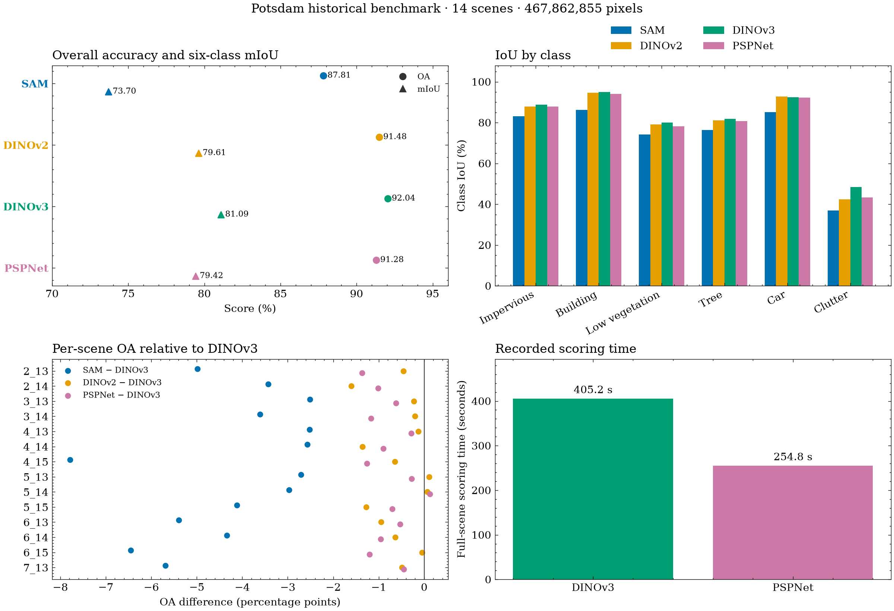
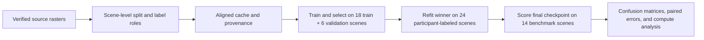
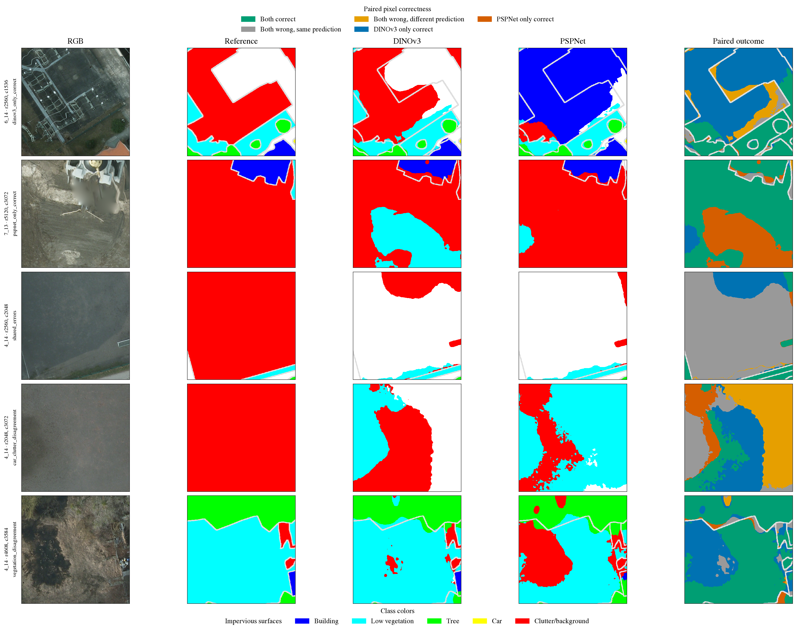
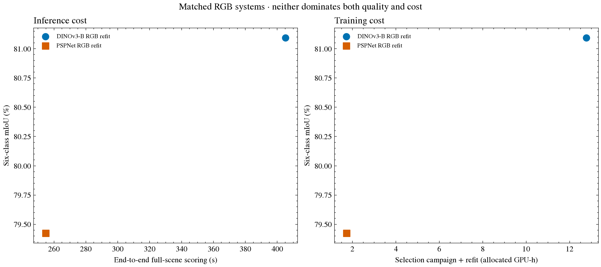

# DeepNet: understanding accuracy, failures, and compute in aerial segmentation

DeepNet builds a reproducible training and evaluation pipeline for high-performing
single-model segmentation of satellite and aerial imagery. This study uses that
pipeline to explain where the recorded Potsdam systems agree, where their predictions
change, and what quality costs in training and inference. It does not propose a new
segmentation algorithm or use an ensemble.

## What the Potsdam results show



*The plot combines aggregate OA and six-class mIoU, per-class IoU, per-scene OA
differences, and recorded full-scene scoring time. All four rows cover the same
historical 14-scene cohort and 467,862,855 scored pixels. DINOv3 and PSPNet share the
RGB cache, split, eroded reference, 512×512 windows, stride 256, and batch size 4.
SAM and DINOv2 retain their earlier input and inference recipes, so those rows compare
complete systems rather than isolated architectures.*

| System | OA | Six-class mIoU | Incorrect pixels | Comparison scope |
| --- | ---: | ---: | ---: | --- |
| SAM ViT-B + LoRA | 87.8142% | 73.7024% | 57,012,689 | Historical recipe |
| DINOv2 ViT-B/14 refit | 91.4785% | 79.6122% | 39,868,882 | Historical recipe |
| PSPNet–ResNet101 RGB refit | 91.2834% | 79.4235% | 40,781,843 | Matched RGB recipe |
| **DINOv3 ViT-B/16 RGB refit** | **92.0397%** | **81.0932%** | **37,243,220** | **Matched RGB recipe** |

The strongest recorded single model is DINOv3-B RGB. It exceeds PSPNet by 0.7563
overall-accuracy points and 1.6697 mIoU points, while PSPNet scores full scenes faster
(254.83 s versus 405.23 s in the archived matched benchmark). This is a quality–cost
trade-off between two complete recipes, not a universal architecture ranking.

## From data integrity to model behavior

The result is meaningful only with its data and scoring contract. Potsdam has 18
training, 6 validation, and 14 benchmark scenes. The split is made by scene before
patches are sampled; training uses participant labels and validation/benchmark scoring
uses eroded labels. The RGBIR archive is documented as red, green, blue, infrared, and
the DINOv3 encoder receives the verified RGB bands. The [data profile](docs/research/potsdam-vaihingen-data-profile-2026-11-07.md)
records band semantics, raster alignment, label support, and DSM checks. nDSM JPEGs
remain excluded because their registration and height encoding are not established.

The pipeline preserves that contract from source rasters to reported scores:



The [data pipeline guide](docs/data-pipeline.md), [architecture guide](docs/architecture.md),
and [evaluation configuration](pipelines/evaluation/dvc.yaml) describe the implementation.
The benchmark numbers below are recomputed from archived per-scene confusion matrices;
the paired analysis additionally checks each prediction map against its hash and then
recomputes those matrices from the held-out cache.

### Selection results constrain the research claims

The DINOv3 selection compared the RGB-only A recipe with a bundled auxiliary-feature
recipe B and stronger augmentation C. A was confirmed with seed 43. Horizontal-flip TTA
did not meet its predeclared gain threshold.

| DINOv3 validation arm | Recipe | OA | mIoU |
| --- | --- | ---: | ---: |
| A | RGB, baseline augmentation | **93.0441%** | **80.7498%** |
| B | A plus IR, index, DSM relief, and availability | 92.9923% | 80.6097% |
| C | A with stronger augmentation | 92.9690% | 80.5115% |
| Seed-43 confirmation | A recipe, independent seed | 92.9477% | 80.4596% |

These validation results support A for the recipes and seeds tested. They do not show
that infrared, elevation, or stronger augmentation are generally harmful: B bundles
several features, and seed variation is comparable to the A–B difference. See the
[selection review](docs/experiments/potsdam-dinov3-rgbir-v2-selection-summary-2026-11-06.md)
and [negative-results analysis](docs/research/augmentation-and-modality-negative-results.md).

After selection, the DINOv3 winner continued for 1,152 updates on the 18 training and
6 former validation scenes using participant labels. The final refit checkpoint was
then scored once on the 14 benchmark scenes. Those scenes were evaluated in earlier
campaigns; they are a historical benchmark cohort, not a newly blind test set.

### Aggregate gains hide where errors move

On the historical DINOv2-to-DINOv3 comparison, DINOv3 raises mIoU by 1.4810 points and
reduces errors by 2,625,662 (6.59%). The largest confusion-count reduction is
clutter→impervious (1,248,458 fewer such errors). Tree→low-vegetation falls by 926,205,
while low-vegetation→tree rises by 425,001. These are changes in confusion counts, not
claims about the same individual pixels being corrected. The comparison changes input,
patch size, decoder, training, and inference recipes, so it cannot identify a backbone-only
effect. See the [error decomposition](docs/research/error-decomposition.md).

The scene-level result is consistent but not uniform: DINOv3 improves OA on 12 of 14
scenes. Removing any one scene leaves the mIoU difference positive, from 1.2636 to
1.6526 points. A scene-cluster bootstrap gives descriptive 95% percentile intervals of
0.2955–0.8458 points for OA and 0.7439–2.2538 for mIoU. Fourteen spatially related
scenes do not make hundreds of millions of pixels independent observations. Details
and prevalence correlations are in [scene-level robustness](docs/research/scene-level-robustness.md).

### Paired predictions reveal corrections and regressions

Separate confusion matrices cannot show whether two systems are wrong on the same
pixels. An inference-only Kaggle job generated paired maps for DINOv3 and PSPNet. The
job reproduced all archived scene matrices; local analysis independently reproduced
them again on all 467,862,855 scored pixels.

| Paired pixel outcome | Count |
| --- | ---: |
| Both correct | 417,385,769 |
| Both wrong | 27,547,977 |
| DINOv3 correct, PSPNet wrong | 13,233,866 |
| PSPNet correct, DINOv3 wrong | 9,695,243 |
| Prediction disagreement | 25,677,823 (5.49%) |

DINOv3's net gain is 3,538,623 correctly classified pixels. The largest class-level
net gains are low vegetation (+1,387,660) and clutter/background (+1,302,537). Of the
shared errors, 24,799,263 receive the same wrong label from both models. This describes
observed pixel decisions; it does not establish why the models fail.



The overview shows one example from each category. The full 20-case gallery is selected
by pixel counts in a non-overlapping grid: DINOv3-only corrections, PSPNet-only
corrections, shared errors, car/clutter disagreement, and tree/low-vegetation
disagreement. See the [failure taxonomy and case studies](docs/research/failure-taxonomy-and-case-studies.md)
for all panels and selection counts. Because the reference is eroded, these maps cannot
establish full-boundary accuracy.

### Accuracy has a measured compute cost

The matched RGB systems occupy different measured points on the quality–cost frontier.
DINOv3's full-scene scoring was 59.0% slower in the archived profile; PSPNet reduced
scoring time by 37.1%. Training cost depends on the number of configurations tested:
the full DINOv3 selection and refit used 12.7705 GPU-hours, while the winning A arm plus
refit proxy used 3.5291; PSPNet selection plus refit used 1.7235 GPU-hours.



The paired inference also measured peak PyTorch CUDA memory on the active Tesla T4:
DINOv3 used 691 MiB allocated / 1,028 MiB reserved, and PSPNet used 422 / 504 MiB.
The successful paired job cost 0.4741 allocated GPU-hours; including two earlier
bootstrap failures, the supplemental analysis used 0.5478 GPU-hours. These memory and
supplemental runtime measurements are documented separately from the archived scoring
profile in [quality and cost](docs/research/quality-cost-analysis.md).

## What the study can and cannot conclude

The study characterizes recorded single-model Potsdam recipes: which confusions changed,
how results vary by scene, what tested additions failed to improve validation mIoU, and
what compute the measured quality difference required. It does not demonstrate
generalization to an unseen city, isolate the causal effect of a backbone, explain the
physical cause of individual errors, or establish full-boundary quality. All four model
rows are single models; no ensemble is used.

The complete research narrative and evidence are in the [empirical study](docs/research/empirical-study.md).
Read its supporting analyses in this order:

1. [Claims and evidence](docs/research/claims-and-evidence.md)
2. [Error decomposition](docs/research/error-decomposition.md)
3. [Scene-level robustness](docs/research/scene-level-robustness.md)
4. [Modality and augmentation negative results](docs/research/augmentation-and-modality-negative-results.md)
5. [Paired failures and case studies](docs/research/failure-taxonomy-and-case-studies.md)
6. [Quality and computational cost](docs/research/quality-cost-analysis.md)

## Dataset and evaluation contract

| Dataset | Scene roles | Training labels | Validation / benchmark labels |
| --- | --- | --- | --- |
| [ISPRS Potsdam](https://www.isprs.org/resources/datasets/benchmarks/UrbanSemLab/2d-sem-label-potsdam.aspx) | 18 train / 6 validation / 14 benchmark | Participant labels | Eroded labels |
| [ISPRS Vaihingen](https://www.isprs.org/resources/datasets/benchmarks/UrbanSemLab/2d-sem-label-vaihingen.aspx) | 12 train / 4 validation / 17 benchmark | Participant labels | Eroded labels |

The six scored classes are impervious surfaces, building, low vegetation, tree, car,
and clutter/background. Label ID 6 is ignored. OA is the share of scored pixels
classified correctly; mIoU is the unweighted mean of the six class IoUs. Per-scene
confusion matrices are summed before aggregate metrics are calculated.

The 14 Potsdam benchmark scenes have been used in earlier campaigns. Historical SAM
and DINOv2 recipes also use different inputs, training choices, and tiling from the
matched RGB pair. The archived joint DINOv2 experiment on Potsdam and Vaihingen is a
separate historical protocol; its scores should not be ranked against the four rows
above without accounting for those differences. See the [joint DINOv2 review](docs/experiments/isprs-dinov2-joint-final-review-2026-11-01.md).

## Reproduce the analysis

Model checkpoints, raster caches, source imagery, per-pixel prediction maps, and Kaggle
logs remain outside Git. With the verified Kaggle output and held-out cache, regenerate
the paired tables and case galleries, then the complete metric report and figures:

```bash
uv sync --locked --extra notebooks
uv run --locked --extra notebooks python scripts/research/paired_analysis.py \
  --kaggle-output /path/to/attempt-3/outputs \
  --cache /path/to/potsdam-dinov3-rgbir-v2/heldout-cache \
  --runs-root /path/to/runs --output-dir docs/research
uv run --locked --extra notebooks python scripts/research/potsdam_empirical.py \
  --runs-root /path/to/runs --output-dir docs/research \
  --paired-manifest /path/to/attempt-3/outputs/paired/paired-predictions.json
```

Recreate the consolidated README model figure from archived metrics with:

```bash
uv run --locked --extra notebooks python scripts.render_scienceplots model-comparison \
  /path/to/runs/potsdam-pspnet-rgb-v1 \
  docs/experiments/figures/potsdam-four-model-benchmark-scienceplots-2026-11-07.png \
  --dinov3-run /path/to/runs/potsdam-dinov3-rgbir-v2
```

For a new experiment, begin with the [DINOv3 protocol](docs/experiments/potsdam-dinov3-rgbir-v2.md),
[data pipeline guide](docs/data-pipeline.md), and
[model architecture guide](docs/architecture.md). DINOv3 pretrained weights require
gated Hugging Face access. The project layout is:

| Directory | Purpose |
| --- | --- |
| [`configs/`](configs/) | Dataset splits, model inputs, and experiment protocols |
| [`deepnet/data/`](deepnet/data/) | Raster catalog, splits, sampling, and evaluation |
| [`deepnet/models/`](deepnet/models/) | Pretrained encoders, adapters, and decoders |
| [`deepnet/potsdam_rgbir/`](deepnet/potsdam_rgbir/) | DINOv3 cache, model checks, and training phases |
| [`notebooks_src/`](notebooks_src/) | EDA and augmentation analyses paired with notebooks |
| [`docs/experiments/`](docs/experiments/) | Frozen protocols, results, and artifact reviews |
| [`docs/research/`](docs/research/) | Data profiles and empirical analyses |
