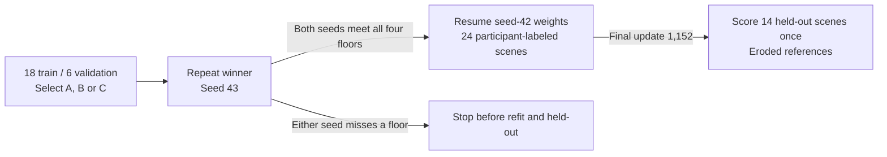

# DeepNet: Semantic Labeling of Aerial Imagery

DeepNet studies semantic segmentation of high-resolution aerial orthophotos with
pretrained vision encoders. Its data pipeline verifies raster alignment and label
provenance, assigns whole scenes before sampling patches, and exports checksummed
bundles that the same code can read locally or on Kaggle.

The completed Potsdam campaign tests DINOv3 with verified RGB encoder inputs,
separate IR/DSM features and stronger augmentation under a fresh 24 allocated-GPU-hour
budget. Validation selects RGB-only DINOv3-B; its final checkpoint continues on
all 24 participant-labeled scenes before a single historical-benchmark evaluation.
OA >=99% remains a research target; the measured results below retain the gap.

[DINOv3 RGBIR protocol](docs/experiments/potsdam-dinov3-rgbir-v2.md) ·
[Completed DINOv2 protocol](docs/experiments/potsdam-dinov2-coverage-refit.md) ·
[Data pipeline guide](docs/data-pipeline.md) · [Architecture](docs/architecture.md)

## Verified results

The final **DINOv3-B RGB model reaches 92.0397% OA and
81.0932% six-class mIoU** on exactly 467,862,855 valid pixels from
14 Potsdam scenes. Relative to the previous DINOv2 refit, OA changes by
**+0.5612 percentage points** and mIoU by
**+1.4810 points**. The **99% OA target was not
reached**: the shortfall is 6.9603 points, with
37,243,220 remaining errors. The
[final DINOv3 artifact review](docs/experiments/potsdam-dinov3-rgbir-v2-final-review-2026-11-06.md)
recomputes every class/scene score from saved matrices and verifies the checkpoint,
cache, one-time evaluation and full 13.4557 GPU-hour allocation ledger.


OA improves on 12 of 14 scenes and IoU on five of six classes. Clutter IoU gains
6.0635 points to 48.4383%; car IoU falls 0.2816 point to 92.4418%. The final model
makes 2,625,662 fewer errors than the DINOv2 refit, a 6.59% reduction. Reaching
99% would still require 32,564,592 fewer errors, or 87.44% of those remaining.

The 14 scenes have been observed in earlier campaigns, so this is a comparison
on a historical benchmark. It is not fresh independent validation. The new
512/256 inference protocol and complete training recipe differ from the older
504/252 DINOv2 recipe; the score difference cannot isolate the backbone or the
effect of adding six scenes to refit. The
[previous DINOv2 review](docs/experiments/potsdam-dinov2-coverage-refit-final-review-2026-11-05.md)
retains its 91.4785% OA / 79.6122% mIoU result and original artifacts.

The [DINOv3 GPU preflight](docs/experiments/potsdam-dinov3-rgbir-v2-preflight-2026-11-05.md)
verified real pretrained B/L weights and gradients. B reached 95.39% train mIoU
on eight fixed patches. Cached full-scene inference matched Rasterio exactly
while taking 3.17 times less time. Eight passes fit the ViT-B budget; satellite
L passes the quality gate but exceeds its cost limit and is excluded.

The [selection and confirmation review](docs/experiments/potsdam-dinov3-rgbir-v2-selection-summary-2026-11-06.md)
selects RGB-only A at **93.0441% validation OA / 80.7498% mIoU**, versus
92.9923% / 80.6097% for B with auxiliary features and 92.9690% / 80.5115% for C
with enhanced augmentation. Seed 43 confirms A's recipe at **92.9477% / 80.4596%**,
passing all four historical C floors. Horizontal-flip TTA gains only
0.0786/0.0690 OA point, below the required 0.1 for both seeds; identity inference
was locked before refit. Auxiliary features and enhanced augmentation do not
improve OA in these seed-42 ablations. They are implemented and measured, while
the final model follows the declared validation ranking.


The [refit](https://www.kaggle.com/code/damminhtien/potsdam-dinov3-rgbir-v2-refit-run)
completes exactly 1,152 updates on 24 participant-labeled scenes, without validation
or checkpoint selection. Its locked final checkpoint is scored once by the
[benchmark job](https://www.kaggle.com/code/damminhtien/potsdam-dinov3-rgbir-v2-heldout-run).
Validation scores above belong to the pre-refit checkpoints. Full scoring uses
512x512 windows, stride 256 and eroded references; the historical DINOv2 tables
below retain their original 504/252 protocol.

The RGBIR source audit also found that the historical three-band files match
RGBIR bands 4/2/3 across all 38 scenes, although their configured names were
IR/red/green. Historical scores and files are preserved; interpret those channel
and spectral-index descriptions with this measured discrepancy. The new RGB
path is byte-verified against the independent official RGB archive and its index
uses the actual IR/red bands 4/1.

### Potsdam DINOv2 coverage study

The table reports the selected checkpoint from each configuration on the same
**6 validation scenes and 199,409,714 scored pixels**. A, B and C use seed 42.
D repeats C with seed 43. Each arm ran four passes with full-scene validation
at updates 1,728 and 3,456. All checkpoints below are from update 3,456.

| Configuration | OA | mIoU | Car IoU | Clutter IoU |
| --- | ---: | ---: | ---: | ---: |
| Historical SAM validation floors | 89.89% | 74.32% | 85.72% | 32.78% |
| A: IRRG + D4 | 92.85% | 79.52% | 92.96% | 38.97% |
| B: A + spectral index and DSM relief | 92.76% | 79.30% | 92.73% | 38.65% |
| **C: A + affine and optical gain, seed 42** | **92.90%** | **79.56%** | **92.96%** | **38.98%** |
| D: C recipe, seed 43 | 92.71% | 79.28% | 92.92% | 38.31% |

[C](https://www.kaggle.com/code/damminhtien/potsdam-dinov2-coverage-refit-v1-c)
won the declared seed-42 ranking, and
[D](https://www.kaggle.com/code/damminhtien/potsdam-dinov2-coverage-refit-v1-d)
cleared all four confirmation floors. Both job outputs are private.
C improved on SAM by 3.01 percentage points in OA and 5.24 in mIoU on validation.
Its advantage over A was only 0.04 points in each metric, which does not establish
a robust augmentation gain. B tested the spectral index and DSM together, so the
result does not isolate either feature's effect.

The pilot reached **94.48% train mIoU** after 64 updates on eight fixed training
patches. On a separate 36-patch input panel, the normalized third-channel median
moved from −3.79 with the historical adapter to −0.51 at initialization with the
residual adapter. Validation took 24.28% of timed training plus validation for A,
36.51% for B, 24.37% for C and 24.30% for D, versus 92.83% in the older joint run.

The table above describes validation before the 24-scene continuation. The former
validation scenes entered the train-only refit bundle with participant labels.
Refit completed 1,152 updates; its final weights were scored once on held-out.
See the [artifact review](docs/experiments/potsdam-dinov2-coverage-refit-final-review-2026-11-05.md)
for completion and audit evidence.

### Full-scene results

| Experiment | Dataset | Held-out scenes | Scored pixels | OA | mIoU |
| --- | --- | ---: | ---: | ---: | ---: |
| SAM ViT-B + LoRA | Potsdam | 14 | 467,862,855 | 87.81% | 73.70% |
| Potsdam DINOv2 C + 24-scene refit | Potsdam | 14 | 467,862,855 | 91.48% | 79.61% |
| **Potsdam DINOv3-B RGB + 24-scene refit** | **Potsdam** | **14** | **467,862,855** | **92.04%** | **81.09%** |
| Joint DINOv2 ViT-B/14 + LoRA | Potsdam | 14 | 467,862,855 | 74.66% | 48.65% |
| Joint DINOv2 ViT-B/14 + LoRA | Vaihingen | 17 | 81,991,943 | 78.30% | 49.18% |

The previous DINOv2 refit improves OA and mIoU over SAM on all 14 Potsdam scenes
and IoU on all six classes. Building IoU is 94.66%, car IoU 92.72% and clutter
IoU 42.37%. Clutter recall remains 51.33%, and tree/low-vegetation confusions
account for 29.63% of all errors. The completed phases used 13.30 runner-accounted
GPU-hours, charging both allocated T4s; execution logs including bootstrap and
the failed initial preflight total about 13.47 allocated GPU-hours.

The [joint DINOv2 artifact review](docs/experiments/isprs-dinov2-joint-final-review-2026-11-01.md)
verifies the original checkpoints, scene counts and confusion matrices. The
comparison with SAM is between complete recipes with different training schedules
and inference tiling. The joint run used both datasets for training, so its
Vaihingen result measures held-out scenes within a joint run.

## Data and evaluation protocol

| Dataset | Project scene split | Labels used by each role |
| --- | --- | --- |
| [ISPRS Potsdam](https://www.isprs.org/resources/datasets/benchmarks/UrbanSemLab/2d-sem-label-potsdam.aspx) | 18 train / 6 validation / 14 held-out | Participant labels for train; eroded labels for validation and held-out |
| [ISPRS Vaihingen](https://www.isprs.org/resources/datasets/benchmarks/UrbanSemLab/2d-sem-label-vaihingen.aspx) | 12 train / 4 validation / 17 held-out | Participant labels for train; eroded labels for validation and held-out |

The 18/6 partition within the 24 participant-labeled Potsdam scenes is a project
choice. Patch sampling and fitted statistics use training scenes only during
selection. Metrics cover six classes: impervious surfaces, buildings, low
vegetation, trees, cars and clutter/background. Label ID 6 is ignored. OA is the
fraction of valid pixels classified correctly; mIoU averages the six class IoUs.
The evaluator sums per-scene confusion matrices before computing aggregate scores.
These are project scores against local references; they are not submissions to
the ISPRS leaderboard.

Both Potsdam studies retain the 18/6 selection roles, require seed-43 confirmation,
then continue seed 42 on all 24 participant-labeled scenes. The DINOv3 campaign
uses eight selection passes and 512/256 inference; details and timings are in its
[protocol](docs/experiments/potsdam-dinov3-rgbir-v2.md).

In the completed DINOv2 study, each selection pass contains 2,592 base windows of
**504 × 504 pixels**, plus
432 car-prioritized and 432 clutter-prioritized draws. Four microbatches per
optimizer step give **864 updates per pass**. A fixed 72-window validation probe
tracks progress. Only full-scene validation at the prescribed checkpoints can
select a model. Full-scene scoring uses **504 × 504 windows with stride 252**
and weighted overlap.



Refit resets AdamW and the mixed-precision scaler and uses half the selection
learning rates. It completes one pass on a separate train-only bundle of 24
scenes. The former validation scenes enter this bundle with their participant
labels. Their eroded labels play no part in refit or checkpoint choice. The
held-out run requires the final checkpoint hash and scores 467,862,855 valid
pixels. Because held-out is scored only after refit, the study cannot measure
the isolated effect of adding the six scenes.

## Data pipeline and model

1. **Catalog and split.** Dataset descriptors map assets to scenes. The catalog
   records content hashes, band roles and raster grids. Split manifests bind
   scene IDs to label sources. Georeferenced rasters are checked against CRS and
   affine grids; pixel-local pairs require documented source alignment.
2. **Sample and export.** Lazy Rasterio reads yield aligned windows, semantic
   labels and valid-pixel masks. The DINOv3 campaign verifies role-specific
   memory-mapped caches against those source reads before training. Bundles and
   caches bind the split, preprocessing, label roles and file-level SHA-256
   inventory; sampling and augmentation are deterministic by seed/pass/draw.
3. **Adapt and segment.** The selected
   [DINOv3-B model](configs/models/dinov3-vitb16-rgbir-v2.json)
   takes named RGB bands through a residual identity adapter into ViT-B/16 with
   LoRA. It applies pretrained normalization at blocks 3/6/9/12 and uses a
   width-128 decoder with GroupNorm and a stride-four detail branch. The four
   block features share the same ViT patch grid and are resized for fusion.
4. **Record provenance.** Run manifests bind the source, data, runtime, training
   protocol, checkpoint and metrics. Persisted confusion matrices allow scores
   to be recomputed without model inference.

The [separate Potsdam DSM snapshot](data/auxiliary/potsdam-dsm-v1.dvc) tracks the
verified source TIFFs and world files. B uses local DSM relief and an availability
mask. Scene `3_13` is one column short; missing DSM pixels retain their original
scoring eligibility. The older five-channel DSM+nDSM view remains blocked
because JPEG nDSM registration and height encoding have not been established.
The historical DINOv2 winning C recipe uses IRRG without elevation or the spectral
index. Its [model spec](configs/models/dinov2-vitb14-multimodal-v3.json) retains
ViT-B/14, the residual IRRG adapter and its frozen training contract.

The [DINOv3-B spec](configs/models/dinov3-vitb16-rgbir-v2.json) selects RGB
by band name and applies the pretrained DINOv3 `norm`. When enabled, IR,
post-augmentation NDVI and verified relief enter a separate branch with a
zero-initialized gate. The selected A recipe keeps that auxiliary branch off.
The compact decoder and detail/fusion blocks use GroupNorm. Role-scoped scene
caches bind source hashes, labels, split and preprocessing; DSM availability
does not remove scored pixels. The
[satellite L spec](configs/models/dinov3-vitl16-rgbir-sat-v2.json) passes the
small-fit quality gate, but its measured cost excludes it from this campaign's
selection roster.

The [joint DINOv3 configuration](configs/training/isprs-dinov3-joint-v2.json)
is an unexecuted training plan. An offline check of a pinned DINOv3 ViT-B/16
snapshot verified gradient flow through 48 LoRA B tensors on a real Potsdam
patch. This smoke check provides no trained-model accuracy.
[DINOv3 weights](https://huggingface.co/facebook/dinov3-vitb16-pretrain-lvd1689m)
require gated access; review the model's terms for the intended use.

## Reproduce

Use Python 3.10 or newer. Install the extras needed for training, data
versioning and development:

```bash
uv sync --extra dev --extra train --extra models --extra vision --extra data-versioning
uv run deepnet-data --help
uv run python -m deepnet.potsdam_study --help
uv run python -m deepnet.potsdam_rgbir.study --help
```

Configure a DVC remote with the matching source objects or follow the
[data pipeline guide](docs/data-pipeline.md) to stage permitted source files.
The default DVC pipeline builds only train/validation bundles:

```bash
uv run dvc pull
uv run dvc repro
uv run deepnet-data verify-bundle --bundle data/prepared/potsdam/train-validation-bundle
```

Build test-only bundles through the [separate evaluation pipeline](pipelines/evaluation/dvc.yaml)
and attach them only to the corresponding evaluation job. Follow the
[DINOv3 RGBIR runbook](docs/experiments/potsdam-dinov3-rgbir-v2.md) to
verify pretrained snapshots, run the CUDA pilot, package private Kaggle inputs
and submit selection, refit and held-out jobs in order. Keep Kaggle's
accelerator-specific Torch build. Store checkpoints, logs, rasters and
credentials outside Git. For the historical joint run, use its
[frozen training configuration](configs/training/isprs-dinov2-joint-v1.json)
and [evaluation protocol](configs/evaluations/isprs-dinov2-v1.json).

| Path | Start here for |
| --- | --- |
| [`configs/`](configs/) | Versioned datasets, splits, model inputs, model specs and experiment settings |
| [`deepnet/data/`](deepnet/data/) | Raster, bundle, sampling and evaluation APIs |
| [`deepnet/models/`](deepnet/models/) | Pretrained backbones, domain adapters and segmentation decoders |
| [`deepnet/potsdam_rgbir/`](deepnet/potsdam_rgbir/) | Current DINOv3 RGBIR caches, model checks, study phases and protocol |
| [`deepnet/potsdam_study.py`](deepnet/potsdam_study.py) | Historical DINOv2 coverage, continuation and held-out commands |
| [EDA notebook](notebooks/data_eda_augmentation.ipynb) and [Jupytext source](notebooks_src/data_eda_augmentation.py) | Dataset inventory, label balance and augmentation audits |
| [`docs/experiments/`](docs/experiments/) | Runbooks, historical metrics and artifact reviews |

For development checks with the extras installed:

```bash
uv run ruff check \
  deepnet scripts model_script semantic_labeling tests notebooks_src \
  test_kernel/test.py
uv run pytest tests/unit
uv run pyright deepnet/potsdam_rgbir/types.py
uv run pyright deepnet/potsdam_rgbir/protocol.py
uv run pyright deepnet/potsdam_rgbir/model.py
uv run pyright deepnet/potsdam_rgbir/sampling.py
uv run pyright deepnet/potsdam_rgbir/engine.py
uv run pyright deepnet/potsdam_rgbir/preflight.py
uv run pyright deepnet/potsdam_rgbir/phases.py
uv run pyright deepnet/potsdam_rgbir/study.py
```

The regular unit suite uses synthetic fixtures. Use
`python -m deepnet.potsdam_rgbir.model smoke --help` for offline B/L checks on a real
Potsdam patch with a verified pinned snapshot. The CUDA preflight repeats the
pretrained integration checks before measuring small-fit quality and throughput.
