# DeepNet Satellite Image Labeling

DeepNet provides a reusable data pipeline for high-resolution geospatial semantic
segmentation. The same versioned scene catalog, split manifest, preprocessing spec,
model-input spec, sampler, and bundle format are used on a local machine and on
Kaggle. A model caller can pass a contract-checked tensor through a thin adapter.

Historical experiment reports, training runners, and notebook outputs remain
available as records. They predate this pipeline and must be rerun before their
metrics are treated as current results. The old PSPNet/SAM training loops still use
their prior bundle format; new data operations and future model runs should use the
shared `deepnet.data` APIs documented below.

## Data pipeline at a glance

```mermaid
flowchart LR
    A[Immutable source rasters] --> B[Dataset catalog and hashes]
    B --> C[Scene-level split manifest]
    C --> D[Alignment and quality checks]
    D --> E[Lazy windows, labels, and masks]
    E --> F[Sampling and model input view]
    F --> G[DataLoader]
    G --> H[Thin model adapter]
    H --> I[Caller-owned model and training loop]
    I --> J[Evaluation and run provenance]
```



Dataset IDs and versioned JSON contracts describe source assets, labels, splits,
preprocessing, and model inputs. Machine-specific data paths are passed at runtime.
The same verified bundle and data contracts work on a local Mac, Kaggle GPU, or
server; runtime selection uses MPS, CUDA, or CPU as available. Adapters only enforce
the tensor boundary, leaving model construction and training to the caller. See the
[data pipeline guide](docs/data-pipeline.md) for setup and end-to-end commands.

## Supported data

The initial catalog descriptors cover ISPRS Potsdam and Vaihingen. Source imagery
and labels are external inputs; they are not stored in Git. Set the data root to the
directory containing the configured source folders. Do not edit raw assets in place.

The Potsdam `potsdam-legacy-v1` manifest records its former 18/6/14 scene assignment
for a reproducible rerun. It prevents scene overlap, but it is not a region-held-out
evaluation. The catalog records Vaihingen rasters as pixel-local where the source
files contain no georeferencing metadata.

The source inventory has 33 Vaihingen images and 17 scenes without the participant
label asset. Use the catalog's per-scene asset inventory to define a supervised
split; the pipeline does not fill or infer missing labels.

The five-channel model views require IRRG, DSM, and nDSM. The currently cataloged
nDSM JPEG has no verified spatial registration evidence, so those views correctly
fail alignment validation until a verified co-registration record is supplied.
IRRG-only views can be exported from the same catalog without weakening that check.

## Install locally

Use Python 3.10 or newer. `uv` is recommended for an isolated local environment:

```bash
uv sync --extra dev --extra train
```

Or use pip in a virtual environment:

```bash
python -m pip install -e ".[dev,train]"
```

`rasterio` is a required data dependency. PyTorch is optional for catalog, quality,
and bundle operations, and is installed by the `train` extra for local model runs.
Ruff is the configured source-style checker.

## Prepare data locally

Pass the source root explicitly. This keeps workstation, server, and Kaggle paths out
of the checked-in dataset descriptors.

```bash
export DEEPNET_DATA_ROOT="/path/to/inputs"

deepnet-data build-catalog \
  --dataset-id isprs-potsdam \
  --data-root "$DEEPNET_DATA_ROOT" \
  --output "$DEEPNET_DATA_ROOT/manifests/potsdam-catalog.json" \
  --hash-assets

deepnet-data validate-catalog \
  --catalog "$DEEPNET_DATA_ROOT/manifests/potsdam-catalog.json" \
  --split configs/splits/potsdam-legacy-v1.json \
  --view-assets irrg-view=irrg
```

`--hash-assets` computes SHA-256 once during catalog creation. Training reuses those
records; it does not rehash source imagery every epoch. Keep catalogs, fitted
preprocessing versions, bundles, and run outputs outside the repository when they
contain dataset paths or large assets.

For model views with z-score normalization, fit statistics from training windows:

```bash
deepnet-data fit-statistics \
  --catalog "$DEEPNET_DATA_ROOT/manifests/potsdam-catalog.json" \
  --split configs/splits/potsdam-legacy-v1.json \
  --preprocessing-id isprs-canonical \
  --model-input-id isprs-irrg-zscore-v1 \
  --data-root "$DEEPNET_DATA_ROOT" \
  --output "$DEEPNET_DATA_ROOT/manifests/isprs-canonical.json"
```

The fitted file advances the preprocessing version and records the split hash and
training scene IDs. Use `--preprocessing-dir` to select that saved spec when
exporting. Five-channel views also need train-only DSM/nDSM statistics and remain
blocked until all selected assets pass the alignment contract.

Export a portable bundle for any configured model view:

```bash
deepnet-data export-bundle \
  --catalog "$DEEPNET_DATA_ROOT/manifests/potsdam-catalog.json" \
  --split configs/splits/potsdam-legacy-v1.json \
  --preprocessing-id isprs-canonical \
  --model-input-id isprs-irrg-zscore-v1 \
  --data-root "$DEEPNET_DATA_ROOT" \
  --output "$DEEPNET_DATA_ROOT/bundles/potsdam-irrg-native-v1"

deepnet-data verify-bundle \
  --bundle "$DEEPNET_DATA_ROOT/bundles/potsdam-irrg-native-v1"
```

The exporter copies only the assets required by the selected view and the labels
assigned to each split. It embeds the contracts and verifies every file hash before
use.

## Use on Kaggle GPU

1. Enable a GPU accelerator in the Kaggle notebook settings.
2. Build a pure-Python wheel with the command in
   [the data pipeline guide](docs/data-pipeline.md), then attach that wheel and a
   bundle produced by `deepnet-data export-bundle` as Kaggle inputs.
3. Install Rasterio only if the Kaggle image does not already provide it. Avoid
   reinstalling PyTorch; Kaggle's Torch build is matched to the configured GPU.
4. Install the wheel and verify the bundle before creating a model or DataLoader:

```python
%pip install --no-deps /kaggle/input/deepnet-wheel/deepnet_satellite_labeling-0.1.0-py3-none-any.whl
```

Then import the shared runtime and data contracts:

```python
from pathlib import Path

import torch

from deepnet.data.bundles import load_bundle
from deepnet.runtime import configure_torch_runtime

runtime = configure_torch_runtime()
if runtime.device.type == "cuda":
    print(torch.cuda.get_device_name(runtime.device))

bundle = load_bundle(Path("/kaggle/input/potsdam-irrg-native-v1"))
train_access = bundle.scene_access("train")
```

The runtime helper selects CUDA when available, Apple MPS on supported Macs, and
CPU otherwise. It enables pinned memory and non-blocking transfers only for CUDA.
The default CUDA worker count is small and can be overridden for the Kaggle
accelerator or local machine. Use `/kaggle/working` for logs and checkpoints, then
save those outputs as notebook artifacts; Kaggle input mounts are read-only and
working storage is temporary.

Local and Kaggle runs consume the same bundle and contracts. Only the source root,
device, worker count, and output root differ. Runtime versions and the selected
device belong in each run manifest.

## Pipeline modules

| Module | Responsibility |
| --- | --- |
| `deepnet.data.contracts` | Immutable raster, scene, split, window, preprocessing, model-input, and sample contracts |
| `deepnet.data.catalog` | Dataset ID descriptors and scene catalog construction |
| `deepnet.data.raster` | Raster metadata checks, alignment, masks, and lazy window reads |
| `deepnet.data.preprocessing` | Palette decoding, named model views, and train-only statistics |
| `deepnet.data.sampling` | Deterministic random sampling, class-aware sampling, and grid coverage |
| `deepnet.data.dataset` | Shared scene access, patches, collators, and Torch DataLoader factory |
| `deepnet.data.evaluation` | Overlap-weighted full-scene predictions and confusion aggregation |
| `deepnet.data.bundles` | Portable, checksummed local/cloud bundles |
| `deepnet.data.lineage` | Run manifest provenance and contract hashes |
| `deepnet.runtime` | CUDA/MPS/CPU selection and host-aware loader defaults |
| `deepnet.models.adapter` | Thin tensor-contract boundary around a caller-provided model |

## Development checks

```bash
ruff check deepnet tests/unit
ruff format --check deepnet tests/unit
pytest tests/unit
```

The data tests use synthetic GeoTIFFs and do not read, rewrite, or require the real
raw datasets. Existing experiment notebooks and training artifacts are historical;
new metrics must record the catalog, split, preprocessing, model-input, sampler,
checkpoint, source revision, and runtime hashes and versions.

## Historical evidence

- [Frozen encoder probe summary](docs/experiments/frozen-encoder-probes-2026-10-19.md)
- [Potsdam and Vaihingen foundation encoder evaluation](docs/experiments/potsdam-vaihingen-foundation-probe-2026-10-19.md)
- [Model and sidewalk segmentation research](docs/research/segmentation-model-and-sidewalk-research-2026-10-19.md)
