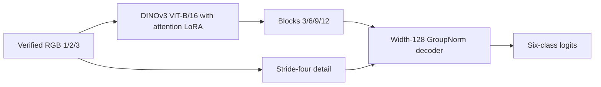

# DeepNet

**Research portfolio | Semantic segmentation of aerial imagery, from verified pixels to full-scene evaluation.**

DeepNet studies six-class urban segmentation on ISPRS Potsdam through source checks, scene-aware preparation, model experiments, and full-scene error analysis. It contributes an auditable pipeline and comparison of single-model recipes, not a new segmentation algorithm.

## Research question and headline result

The study asks what accuracy–compute trade-offs recorded systems show under a scene-aware protocol, where their errors differ, and how tested training choices compare. It does not isolate causal effects of backbones, modalities, or augmentation.

| Strongest recorded Potsdam recipe | Six-class mIoU | Overall accuracy | Scored cohort |
| --- | ---: | ---: | --- |
| **DINOv3-B/16 · verified RGB · single model** | **81.09%** | **92.04%** | 14 historical scenes · 467.9M pixels |

> **Scope.** The 14-scene benchmark was examined in earlier campaigns. These scores are not a new blind test or a state-of-the-art claim. Comparisons describe complete experimental recipes.

## Data integrity and scene-aware preparation

The source audit found that historical local files catalogued as IRRG map to RGBIR bands 4/2/3 (**NIR/green/blue**), not expected 4/1/2 (**NIR/red/green**). DINOv3 reads verified RGB bands 1/2/3 from RGBIR. This finding applies to the audited files; see the [ISPRS product specification](https://www.isprs.org/resources/datasets/benchmarks/UrbanSemLab/2d-sem-label-potsdam.aspx) and [data-profile report](docs/research/potsdam-vaihingen-data-profile-2026-11-07.md).


*Real imagery and participant labels, not predictions. NIR/red/green false-color; per-crop stretch, not calibrated reflectance.*


*Exact current train/validation histograms. Digital numbers are uncalibrated; use named-band routing and train-only normalization.*

Scene assignment precedes sampling: Potsdam uses 18/6/14 scenes, Vaihingen 12/4/17. Their ground sampling distances are 5 cm and 9 cm. Clutter is 5.61% and 0.88% of training pixels respectively; Vaihingen clutter occurs in only 4 of 12 scenes.


*Each point is a training scene; class totals alone hide sparse spatial support.*

Versioned contracts bind source hashes, bands, grids, labels, scene roles, preprocessing, caches, sampling, evaluation, and run provenance. Training uses participant labels; scoring uses eroded references.


*Footprint estimates use GSD, not GIS unions.*

## Benchmark findings: accuracy, cost, and error structure

All systems scored the same 14 scenes and 467,862,855 pixels. Only DINOv3 RGB and PSPNet RGB share the current cache, split, labels, 512 × 512 windows, stride 256, and identity inference.


*Aggregate scores, class IoU, per-scene OA differences, and end-to-end scoring time. SAM and DINOv2 retain historical inference recipes.*

| System | OA | Six-class mIoU | Recorded scoring time |
| --- | ---: | ---: | ---: |
| **DINOv3-B/16 RGB refit** | **92.04%** | **81.09%** | 405.23 s |
| PSPNet–ResNet101 RGB refit | 91.28% | 79.42% | **254.83 s** |
| DINOv2 ViT-B/14 refit | 91.48% | 79.61% | — |
| SAM ViT-B + LoRA | 87.81% | 73.70% | — |

DINOv3 exceeds PSPNet by 1.67 mIoU points; PSPNet used 37.1% less recorded scoring time. This is a recipe-level trade-off on measured runs, not a hardware-independent speed ranking ([CLAIM-005](artifacts/public/evidence-manifest.json)). DINOv3 has the strongest aggregate result in this cohort ([CLAIM-001](artifacts/public/evidence-manifest.json)); details are in [Results](docs/results.md) and the [PSPNet report](docs/experiments/potsdam-pspnet-rgb-v1.md).

On DINOv3, clutter/background remains the weakest class at 48.44% IoU. Tree↔low-vegetation confusions account for 11.31 million pixels, 30.37% of its errors.


*Positive cells mean more pixels in that true→predicted cell for DINOv2; negative cells mean more for DINOv3. Off-diagonals are confusions; diagonals are correct predictions. Recipes differ.*

Paired DINOv3–PSPNet maps show both corrections and regressions ([CLAIM-006](artifacts/public/evidence-manifest.json)).


*Five targeted crops selected by pixel counts, not a random sample. See the [failure analysis](docs/research/failure-taxonomy-and-case-studies.md) for all 20 and their selection records.*

## Tested changes that did not improve validation

On six validation scenes (199,409,714 pixels), RGB baseline A outscored bundled auxiliary recipe B and stronger-augmentation recipe C:

| Configuration | Tested change | Validation mIoU |
| --- | --- | ---: |
| **A · RGB baseline** | Verified RGB, baseline augmentation | **80.75%** |
| B · Auxiliary signals | RGB + IR/index/DSM branch | 80.61% |
| C · Stronger augmentation | RGB with enhanced augmentation | 80.51% |
| D · Seed-43 confirmation | A recipe, independent seed | 80.46% |


*A/B/C use seed 42; full validation at passes 4/8 governed selection. D confirms A with seed 43. See [selection protocol and evidence](docs/experiments/potsdam-dinov3-rgbir-v2-selection-summary-2026-11-06.md) ([CLAIM-007](artifacts/public/evidence-manifest.json)).*

Only the tested bundle and augmentation recipe failed to improve on A; B does not isolate IR, spectral index, or DSM. Horizontal-flip TTA gains for both seeds missed the predeclared 0.10-point OA threshold, so inference remains identity. This does not show individual features are generally ineffective.

## Data pipeline and selected model


The selected DINOv3 ViT-B/16 applies LoRA to attention projections. Blocks 3/6/9/12 share one ViT patch grid; a normalized decoder fuses their features with stride-four detail. This is multi-level semantic fusion, not a hierarchical transformer pyramid.



The seed-42 winner was refit for 1,152 updates on all 24 participant-labeled scenes, then scored on the benchmark. See [architecture](docs/architecture.md), [data pipeline](docs/data-pipeline.md), and the [DINOv3 campaign record](docs/experiments/potsdam-dinov3-rgbir-v2-final-review-2026-11-06.md).

## Reproduction and further reading

Metric reproduction requires only Python's standard library:

```bash
python3 scripts/recompute_public_metrics.py --check
python3 scripts/check_public_docs.py
```

These checks verify matrices, hashes, links, claims, and experiment statuses. This is metric reproduction (R1); imagery, labels, predictions, and checkpoints are not public. See [reproducibility](docs/reproducibility.md), [figure provenance](docs/figures.md), and the [experiment index](docs/experiments/README.md). Baselines: [DINOv2](https://arxiv.org/abs/2304.07193), [DINOv3](https://arxiv.org/abs/2508.10104), [PSPNet](https://openaccess.thecvf.com/content_cvpr_2017/html/Zhao_Pyramid_Scene_Parsing_CVPR_2017_paper.html), and [SAM](https://arxiv.org/abs/2304.02643).

The benchmark is spatially limited and previously examined; there is no matched DINOv3 cross-city evaluation. Controlled modality ablations and geographic evaluation remain future work, marked [`CONFIGURED_NOT_RUN`](docs/experiments/future-study-design.md). Dataset imagery and pretrained weights retain their own terms; the repository does not declare a code license.
