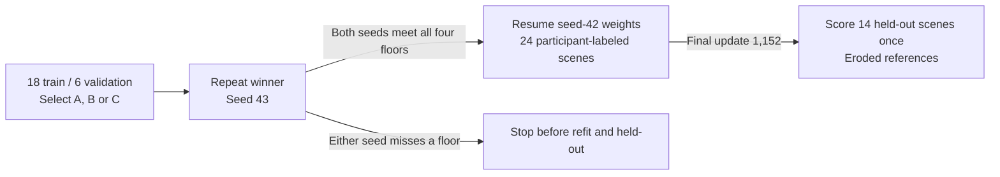

# DeepNet: Semantic Labeling of Aerial Imagery

DeepNet studies semantic segmentation of high-resolution aerial orthophotos with
pretrained vision encoders. Its data pipeline verifies raster alignment and label
provenance, assigns whole scenes before sampling patches, and exports checksummed
bundles that the same code can read locally or on Kaggle.

The current Potsdam study asks whether broader training coverage, a
channel-preserving IRRG adapter, and a smaller DINOv2 decoder can improve on the
historical SAM baseline. It also tests whether spectral and elevation features or
stronger augmentation help under a fixed budget.

[Study protocol and runbook](docs/experiments/potsdam-dinov2-coverage-refit.md) ·
[Data pipeline guide](docs/data-pipeline.md) · [Architecture](docs/architecture.md)

## Verified results

The completed Potsdam study reaches **91.48% held-out OA and 79.61% six-class
mIoU** after continuing the selected DINOv2 checkpoint on 24 labeled scenes.
It improves on historical SAM by **3.66 OA points and 5.91 mIoU points** on
the same 14-scene support. The **99% OA target was not reached**; the gap is
7.52 points. The [final artifact review](docs/experiments/potsdam-dinov2-coverage-refit-final-review-2026-11-05.md)
records the checkpoint, independently recomputed metrics and remaining errors.

### Potsdam DINOv2 coverage study

The table reports the selected checkpoint from each configuration on the same
**6 validation scenes and 199,409,714 scored pixels**. A, B and C use seed 42.
D repeats C with seed 43. Each arm ran four passes with full-scene validation
at updates 1,728 and 3,456. All checkpoints below are from update 3,456.

| Configuration | OA | mIoU | Car IoU | Clutter IoU |
| --- | ---: | ---: | ---: | ---: |
| Historical SAM validation floors | 89.89% | 74.32% | 85.72% | 32.78% |
| A: IRRG + D4 | 92.85% | 79.52% | 92.96% | 38.97% |
| B: A + spectral index and DSM relief | 92.76% | 79.30% | 92.73% | 38.65% |
| **C: A + affine and optical gain, seed 42** | **92.90%** | **79.56%** | **92.96%** | **38.98%** |
| D: C recipe, seed 43 | 92.71% | 79.28% | 92.92% | 38.31% |

[C](https://www.kaggle.com/code/damminhtien/potsdam-dinov2-coverage-refit-v1-c)
won the declared seed-42 ranking, and
[D](https://www.kaggle.com/code/damminhtien/potsdam-dinov2-coverage-refit-v1-d)
cleared all four confirmation floors. Both job outputs are private.
C improved on SAM by 3.01 percentage points in OA and 5.24 in mIoU on validation.
Its advantage over A was only 0.04 points in each metric, which does not establish
a robust augmentation gain. B tested the spectral index and DSM together, so the
result does not isolate either feature's effect.

The pilot reached **94.48% train mIoU** after 64 updates on eight fixed training
patches. On a separate 36-patch input panel, the normalized third-channel median
moved from −3.79 with the historical adapter to −0.51 at initialization with the
residual adapter. Validation took 24.28% of timed training plus validation for A,
36.51% for B, 24.37% for C and 24.30% for D, versus 92.83% in the older joint run.

The table above describes validation before the 24-scene continuation. The former
validation scenes then entered the train-only refit bundle with participant
labels. Refit completed exactly 1,152 updates without validation or checkpoint
selection; its final weights were scored once on held-out. The
[run record](.agent/STATE.md#potsdam-final-refit-and-held-out-audit--2026-11-05)
records completion and audit evidence.

### Held-out results

| Experiment | Dataset | Held-out scenes | Scored pixels | OA | mIoU |
| --- | --- | ---: | ---: | ---: | ---: |
| SAM ViT-B + LoRA | Potsdam | 14 | 467,862,855 | 87.81% | 73.70% |
| **Potsdam DINOv2 C + 24-scene refit** | **Potsdam** | **14** | **467,862,855** | **91.48%** | **79.61%** |
| Joint DINOv2 ViT-B/14 + LoRA | Potsdam | 14 | 467,862,855 | 74.66% | 48.65% |
| Joint DINOv2 ViT-B/14 + LoRA | Vaihingen | 17 | 81,991,943 | 78.30% | 49.18% |

The final refit model improves OA and mIoU over SAM on all 14 Potsdam scenes
and IoU on all six classes. Building IoU is 94.66%, car IoU 92.72% and clutter
IoU 42.37%. Clutter recall remains 51.33%, and tree/low-vegetation confusions
account for 29.63% of all errors. The completed phases used 13.30 runner-accounted
GPU-hours, charging both allocated T4s; execution logs including bootstrap and
the failed initial preflight total about 13.47 allocated GPU-hours.

The [joint DINOv2 artifact review](docs/experiments/isprs-dinov2-joint-final-review-2026-11-01.md)
verifies the original checkpoints, scene counts and confusion matrices. The
comparison with SAM is between complete recipes with different training schedules
and inference tiling. The joint run used both datasets for training, so its
Vaihingen result measures held-out scenes within a joint run.

## Data and evaluation protocol

| Dataset | Project scene split | Labels used by each role |
| --- | --- | --- |
| [ISPRS Potsdam](https://www.isprs.org/resources/datasets/benchmarks/UrbanSemLab/2d-sem-label-potsdam.aspx) | 18 train / 6 validation / 14 held-out | Participant labels for train; eroded labels for validation and held-out |
| [ISPRS Vaihingen](https://www.isprs.org/resources/datasets/benchmarks/UrbanSemLab/2d-sem-label-vaihingen.aspx) | 12 train / 4 validation / 17 held-out | Participant labels for train; eroded labels for validation and held-out |

The 18/6 partition within the 24 participant-labeled Potsdam scenes is a project
choice. Patch sampling and fitted statistics use training scenes only during
selection. Metrics cover six classes: impervious surfaces, buildings, low
vegetation, trees, cars and clutter/background. Label ID 6 is ignored. OA is the
fraction of valid pixels classified correctly; mIoU averages the six class IoUs.
The evaluator sums per-scene confusion matrices before computing aggregate scores.
These are project scores against local references; they are not submissions to
the ISPRS leaderboard.

Each selection pass contains 2,592 base windows of **504 × 504 pixels**, plus
432 car-prioritized and 432 clutter-prioritized draws. Four microbatches per
optimizer step give **864 updates per pass**. A fixed 72-window validation probe
tracks progress. Only full-scene validation at the prescribed checkpoints can
select a model. Full-scene scoring uses **504 × 504 windows with stride 252**
and weighted overlap.



Refit resets AdamW and the mixed-precision scaler and uses half the selection
learning rates. It completes one pass on a separate train-only bundle of 24
scenes. The former validation scenes enter this bundle with their participant
labels. Their eroded labels play no part in refit or checkpoint choice. The
held-out run requires the final checkpoint hash and scores 467,862,855 valid
pixels. Because held-out is scored only after refit, the study cannot measure
the isolated effect of adding the six scenes.

## Data pipeline and model

1. **Catalog and split.** Dataset descriptors map assets to scenes. The catalog
   records content hashes, band roles and raster grids. Split manifests bind
   scene IDs to label sources. Georeferenced rasters are checked against CRS and
   affine grids; pixel-local pairs require documented source alignment.
2. **Sample and export.** Lazy Rasterio reads yield aligned windows, semantic
   labels and valid-pixel masks. The sampler and augmentation policy are
   versioned. Each bundle contains role-specific rasters, split and preprocessing
   contracts, and a file-level SHA-256 inventory.
3. **Adapt and segment.** The current
   [DINOv2 model spec](configs/models/dinov2-vitb14-multimodal-v3.json)
   uses ViT-B/14 with LoRA, a zero-initialized residual IRRG projection,
   pretrained normalization at blocks 3/6/9/12 and a width-128 decoder with
   GroupNorm and a high-resolution detail branch. The four feature levels
   share the same ViT patch grid.
4. **Record provenance.** Run manifests bind the source, data, runtime, training
   protocol, checkpoint and metrics. Persisted confusion matrices allow scores
   to be recomputed without model inference.

The [separate Potsdam DSM snapshot](data/auxiliary/potsdam-dsm-v1.dvc) tracks the
verified source TIFFs and world files. B uses local DSM relief and an availability
mask. Scene `3_13` is one column short; missing DSM pixels retain their original
scoring eligibility. The older five-channel DSM+nDSM view remains blocked
because JPEG nDSM registration and height encoding have not been established.
The winning C recipe uses IRRG without elevation or the spectral index.

The [joint DINOv3 configuration](configs/training/isprs-dinov3-joint-v2.json)
is an unexecuted training plan. An offline check of a pinned DINOv3 ViT-B/16
snapshot verified gradient flow through 48 LoRA B tensors on a real Potsdam
patch. This smoke check provides no trained-model accuracy.
[DINOv3 weights](https://huggingface.co/facebook/dinov3-vitb16-pretrain-lvd1689m)
require gated access; review the model's terms for the intended use.

## Reproduce

Use Python 3.10 or newer. Install the extras needed for training, data
versioning and development:

```bash
uv sync --extra dev --extra train --extra models --extra vision --extra data-versioning
uv run deepnet-data --help
uv run python -m deepnet.potsdam_study --help
```

Configure a DVC remote with the matching source objects or follow the
[data pipeline guide](docs/data-pipeline.md) to stage permitted source files.
The default DVC pipeline builds only train/validation bundles:

```bash
uv run dvc pull
uv run dvc repro
uv run deepnet-data verify-bundle --bundle data/prepared/potsdam/train-validation-bundle
```

Build test-only bundles through the [separate evaluation pipeline](pipelines/evaluation/dvc.yaml)
and attach them only to the corresponding evaluation job. Follow the
[Potsdam study runbook](docs/experiments/potsdam-dinov2-coverage-refit.md) to
verify pretrained snapshots, run the CUDA pilot, package private Kaggle inputs
and submit selection, refit and held-out jobs in order. Keep Kaggle's
accelerator-specific Torch build. Store checkpoints, logs, rasters and
credentials outside Git. For the historical joint run, use its
[frozen training configuration](configs/training/isprs-dinov2-joint-v1.json)
and [evaluation protocol](configs/evaluations/isprs-dinov2-v1.json).

| Path | Start here for |
| --- | --- |
| [`configs/`](configs/) | Versioned datasets, splits, model inputs, model specs and experiment settings |
| [`deepnet/data/`](deepnet/data/) | Raster, bundle, sampling and evaluation APIs |
| [`deepnet/models/`](deepnet/models/) | Pretrained backbones, domain adapters and segmentation decoders |
| [`deepnet/potsdam_study.py`](deepnet/potsdam_study.py) | Potsdam pilot, selection, continuation and held-out commands |
| [EDA notebook](notebooks/data_eda_augmentation.ipynb) and [Jupytext source](notebooks_src/data_eda_augmentation.py) | Dataset inventory, label balance and augmentation audits |
| [`docs/experiments/`](docs/experiments/) | Runbooks, historical metrics and artifact reviews |

For development checks with the extras installed:

```bash
uv run ruff check deepnet tests/unit
uv run pytest tests/unit
```

The regular unit suite uses synthetic fixtures. Use `smoke-dinov3` from the
runbook to check the real pretrained integration with a verified local snapshot.
