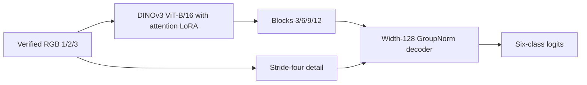

# DeepNet

**Research portfolio | Semantic segmentation of aerial imagery, from verified pixels to full-scene evaluation.**

DeepNet studies Potsdam segmentation through source checks, scene-aware preparation, model experiments, and full-scene error analysis. Contributions are an auditable pipeline and recipe comparisons, not a new algorithm.

## Research question and headline result

We compare accuracy–compute trade-offs and errors under scene-aware evaluation; recipe changes are not controlled causal ablations.

| Strongest recorded Potsdam recipe | Six-class mIoU | Overall accuracy | Scored cohort |
| --- | ---: | ---: | --- |
| **DINOv3-B/16 · verified RGB · single model** | **81.09%** | **92.04%** | 14 historical scenes · 467.9M pixels |

> **Scope.** The 14-scene benchmark was examined in earlier campaigns. These scores are not a new blind test or a state-of-the-art claim. Comparisons describe complete experimental recipes.

## Dataset and download

**Potsdam:** 38 tiles of 6,000 × 6,000 pixels at 5 cm ground sampling distance (GSD), with RGBIR (R/G/B/NIR), IRRG (NIR/R/G), DSM, and six-class labels. DINOv3 uses verified RGB from RGBIR; split: 18/6/14 train/validation/benchmark scenes.

**Vaihingen:** 33 variable-size tiles (9 cm GSD) with NIR/red/green imagery, DSM, and labels. It is profiled here without a matched DINOv3 evaluation.

Download [Potsdam (13.3 GB)](https://seafile.projekt.uni-hannover.de/f/429be50cc79d423ab6c/) or [Vaihingen (16 GB)](https://seafile.projekt.uni-hannover.de/f/6a06a837b1f349cfa749/) via the [ISPRS portal](https://isprs.org/resources/datasets/benchmarks/UrbanSemLab/default.aspx); obtain the current password and terms there. Download one at a time and extract outside Git. With DVC remote access: `dvc pull data/auxiliary/potsdam-rgbir-v2.dvc`. For manual setup, preserve descriptor paths: generic Potsdam cataloging discovers IRRG, while DINOv3 uses RGBIR. See its [runbook](docs/experiments/potsdam-dinov3-rgbir-v2.md) and the [pipeline guide](docs/data-pipeline.md).

## Data integrity and scene-aware preparation

The audit found that historical files catalogued as IRRG map to bands 4/2/3 (**NIR/green/blue**), not 4/1/2 (**NIR/red/green**). DINOv3 reads verified RGB 1/2/3 from RGBIR. This applies to the audited files; see the [ISPRS specification](https://www.isprs.org/resources/datasets/benchmarks/UrbanSemLab/2d-sem-label-potsdam.aspx) and [data-profile report](docs/research/potsdam-vaihingen-data-profile-2026-11-07.md).


*Real imagery and participant labels; NIR/red/green false-color, per-crop stretch.*


*Uncalibrated digital-number histograms for current train and validation splits.*

Splits precede sampling: Potsdam 18/6/14, Vaihingen 12/4/17 (train/validation/benchmark). Clutter is 5.61% vs. 0.88% of training pixels and appears in 4/12 Vaihingen train scenes.


*Each point is a training scene; class totals alone hide sparse spatial support.*

Versioned contracts bind source hashes, bands, grids, labels, scene roles, preprocessing, sampling, evaluation, and provenance. Training uses participant labels; scoring uses eroded references.


*Footprint estimates use GSD, not GIS unions.*

## Benchmark findings: accuracy, cost, and error structure

All systems scored 14 scenes and 467,862,855 pixels. Only DINOv3 RGB and PSPNet RGB share the current cache, split, labels, 512 × 512 windows, stride 256, and identity inference.


*Aggregate/class IoU, per-scene OA differences, and end-to-end time. SAM and DINOv2 use historical inference recipes.*

| System | OA | Six-class mIoU | Recorded scoring time |
| --- | ---: | ---: | ---: |
| **DINOv3-B/16 RGB refit** | **92.04%** | **81.09%** | 405.23 s |
| PSPNet–ResNet101 RGB refit | 91.28% | 79.42% | **254.83 s** |
| DINOv2 ViT-B/14 refit | 91.48% | 79.61% | — |
| SAM ViT-B + LoRA | 87.81% | 73.70% | — |

DINOv3 exceeds PSPNet by 1.67 mIoU points; PSPNet used 37.1% less scoring time in these runs, not a hardware-independent speed ranking ([CLAIM-005](artifacts/public/evidence-manifest.json)). DINOv3 leads this cohort ([CLAIM-001](artifacts/public/evidence-manifest.json)); see [Results](docs/results.md) and the [PSPNet report](docs/experiments/potsdam-pspnet-rgb-v1.md).

On DINOv3, clutter/background remains the weakest class at 48.44% IoU. Tree↔low-vegetation confusions account for 11.31 million pixels, 30.37% of its errors.


*Positive means more DINOv2 pixels; negative, more DINOv3. Off-diagonals are errors, diagonals correct. Recipes differ.*

Paired DINOv3–PSPNet maps show both corrections and regressions ([CLAIM-006](artifacts/public/evidence-manifest.json)).


*Five targeted crops; see all 20 and selection records in the [failure analysis](docs/research/failure-taxonomy-and-case-studies.md).*

## Tested changes that did not improve validation

On six validation scenes (199,409,714 pixels), RGB baseline A outscored bundled auxiliary recipe B and stronger-augmentation recipe C:

| Configuration | Tested change | Validation mIoU |
| --- | --- | ---: |
| **A · RGB baseline** | Verified RGB, baseline augmentation | **80.75%** |
| B · Auxiliary signals | RGB + IR/index/DSM branch | 80.61% |
| C · Stronger augmentation | RGB with enhanced augmentation | 80.51% |
| D · Seed-43 confirmation | A recipe, independent seed | 80.46% |


*A/B/C use seed 42; validation at passes 4/8 selected. D confirms A with seed 43. See [protocol](docs/experiments/potsdam-dinov3-rgbir-v2-selection-summary-2026-11-06.md) ([CLAIM-007](artifacts/public/evidence-manifest.json)).*

The tested auxiliary bundle and stronger augmentation did not improve on A; B does not isolate IR, index, or DSM. Flip TTA gains missed the predeclared 0.10-point OA threshold for both seeds, so inference remains identity. Individual features may still help.

## Data pipeline and selected model


The selected DINOv3 ViT-B/16 applies attention-projection LoRA. Blocks 3/6/9/12 share one patch grid; a normalized decoder fuses these features with stride-four detail. This is multi-level fusion, not a hierarchical pyramid.



The seed-42 winner was refit for 1,152 updates on 24 participant-labeled scenes, then scored on the benchmark. See [architecture](docs/architecture.md) and the [DINOv3 campaign record](docs/experiments/potsdam-dinov3-rgbir-v2-final-review-2026-11-06.md).

## Reproduction and further reading

Metric reproduction requires only Python's standard library:

```bash
python3 scripts/recompute_public_metrics.py --check
python3 scripts/check_public_docs.py
```

The checks verify matrices, hashes, links, claims, and report statuses. This is metric reproduction (R1); imagery, labels, predictions, and checkpoints are not public. See [reproducibility](docs/reproducibility.md), [figure provenance](docs/figures.md), [experiment index](docs/experiments/README.md), and the baseline papers: [DINOv2](https://arxiv.org/abs/2304.07193), [DINOv3](https://arxiv.org/abs/2508.10104), [PSPNet](https://openaccess.thecvf.com/content_cvpr_2017/html/Zhao_Pyramid_Scene_Parsing_CVPR_2017_paper.html), [SAM](https://arxiv.org/abs/2304.02643).

This historical, spatially limited benchmark lacks matched cross-city DINOv3 evaluation; controlled modality ablations and geographic evaluation remain [`CONFIGURED_NOT_RUN`](docs/experiments/future-study-design.md). Dataset imagery and pretrained weights retain their own terms; the repository does not declare a code license.
