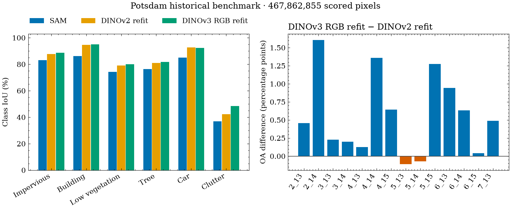

# Potsdam DINOv3 RGBIR v2 final artifact review, 2026-11-06

The selected DINOv3-B RGB model completed its 24-scene continuation at exactly
1,152 updates, and its locked final checkpoint was scored once on the historical
14-scene benchmark. Independently recomputed OA is **92.0397%**
and six-class mIoU is **81.0932%** on exactly **467,862,855 valid pixels**.
The OA difference from the previous DINOv2 refit is
**+0.5612 percentage points**; the mIoU difference is
**+1.4810 points**.
The **99% OA target was not reached**: the remaining gap is
**6.9603 points**.
The complete campaign uses **13.4557472 allocated GPU-hours**
against the new 24-hour budget, including bootstrap, the failed first preflight
and both allocated T4s.

## Final benchmark results

All rows below have the same 14 scene IDs, exact scored counts and ground-truth
class supports. Historical metric files retain their verified hashes. Matching
support does not by itself establish byte-level identity of every historical
reference map. These are local project scores, not an ISPRS leaderboard submission.

| Experiment | OA | Six-class mIoU |
| --- | ---: | ---: |
| SAM | 87.8142% | 73.7024% |
| DINOv2 refit | 91.4785% | 79.6122% |
| DINOv3 RGB refit | 92.0397% | 81.0932% |

The figure compares aggregate class IoUs and each scene's OA difference from the
previous DINOv2 refit. The [SciencePlots rendering](../figures.md#dinov3-reports)
uses the audited tables derived from saved confusion matrices. The original
PNG/PDF remains in the external review. The new policy is identity with 512x512
windows and stride 256;
the DINOv2 reference retains its original 504/252 policy. SAM uses its historical
recipe and tiling. Differences compare complete systems; they do not isolate
the backbone, RGB input, augmentation or continuation effect.

| Class | DINOv2 refit IoU | DINOv3 RGB refit IoU | Difference | DINOv3 F1 |
| --- | ---: | ---: | ---: | ---: |
| Impervious surfaces | 87.8091% | 88.7372% | +0.9281 pp | 94.0325% |
| Building | 94.6559% | 95.0554% | +0.3995 pp | 97.4650% |
| Low vegetation | 79.0312% | 80.0577% | +1.0266 pp | 88.9245% |
| Tree | 81.0786% | 81.8287% | +0.7501 pp | 90.0064% |
| Car | 92.7234% | 92.4418% | -0.2816 pp | 96.0725% |
| Clutter/background | 42.3747% | 48.4383% | +6.0635 pp | 65.2638% |

IoU improves on five of six classes. Clutter gains 6.0635 points, while car IoU
falls by 0.2816 point. Clutter recall rises from 51.3326% to 60.3914%; precision
changes from 70.8307% to 70.9916%. Car recall rises to 98.4353%, but precision
falls to 93.8203%, so its aggregate IoU declines.

The final checkpoint makes **37,243,220 errors**, or **2,625,662 fewer** than
the DINOv2 refit, a **6.59%** reduction.
Tree/low-vegetation confusion in both directions contributes 11,312,236 pixels,
or 30.37% of all errors. The largest directed
confusions are:

| True class | Predicted class | Pixels | Share of all errors |
| --- | --- | ---: | ---: |
| Low vegetation | Tree | 5,975,707 | 16.05% |
| Tree | Low vegetation | 5,336,529 | 14.33% |
| Clutter/background | Impervious surfaces | 3,628,388 | 9.74% |
| Impervious surfaces | Low vegetation | 3,380,493 | 9.08% |
| Low vegetation | Impervious surfaces | 2,510,302 | 6.74% |
| Clutter/background | Low vegetation | 2,261,680 | 6.07% |

At this exact support, 99% OA permits at most **4,678,628** errors. Reaching it
would require **32,564,592 fewer errors**, a net
reduction of **87.44%** from the measured
final result. These counts describe the remaining gap; they do not establish
which model change would close it.

## Per-scene results

OA improves over the previous DINOv2 refit on
**12 of 14 scenes**. Aggregate scores are
computed from summed matrices, not from an unweighted mean of scene scores.
The two OA regressions are `5_13` (-0.1080 point) and `5_14` (-0.0695 point).
Scene `4_14` remains the weakest at 85.9410% OA, despite a 1.3585-point gain.

| Scene | Scored pixels | DINOv2 OA | DINOv3 OA | OA difference | DINOv3 mIoU |
| --- | ---: | ---: | ---: | ---: | ---: |
| `2_13` | 33,112,031 | 92.2660% | 92.7240% | +0.4579 pp | 80.0330% |
| `2_14` | 33,840,315 | 91.7304% | 93.3365% | +1.6061 pp | 79.4943% |
| `3_13` | 32,965,944 | 92.4143% | 92.6437% | +0.2295 pp | 79.6974% |
| `3_14` | 33,189,588 | 91.5149% | 91.7142% | +0.1993 pp | 80.3907% |
| `4_13` | 33,072,636 | 90.8186% | 90.9456% | +0.1270 pp | 75.6824% |
| `4_14` | 33,228,405 | 84.5825% | 85.9410% | +1.3585 pp | 75.6118% |
| `4_15` | 33,125,809 | 92.7802% | 93.4261% | +0.6460 pp | 78.7794% |
| `5_13` | 33,484,544 | 92.3054% | 92.1974% | -0.1080 pp | 78.4836% |
| `5_14` | 33,332,046 | 89.7836% | 89.7140% | -0.0695 pp | 78.3203% |
| `5_15` | 33,302,999 | 90.3011% | 91.5754% | +1.2742 pp | 80.9597% |
| `6_13` | 33,954,901 | 93.8505% | 94.7947% | +0.9443 pp | 84.1208% |
| `6_14` | 33,566,681 | 94.1487% | 94.7824% | +0.6337 pp | 83.7827% |
| `6_15` | 33,343,530 | 93.3275% | 93.3710% | +0.0436 pp | 84.6902% |
| `7_13` | 34,343,426 | 90.8202% | 91.3106% | +0.4904 pp | 78.4851% |

## Selection, modality and inference decisions

The [selection and confirmation review](potsdam-dinov3-rgbir-v2-selection-summary-2026-11-06.md)
retains all A/B/C/D matrices and the frozen ranking. Selection used 18 original
training and six validation scenes, eight passes and 6,912 updates per arm.
Only full validations at passes 4 and 8 could select a checkpoint, on exactly
199,409,714 eroded-label pixels. Every arm starts from pinned pretrained weights.

A wins at **93.0441% validation OA / 80.7498% mIoU**. B's combined IR/index/DSM
branch scores 92.9923% / 80.6097%; C's enhanced augmentation scores 92.9690% /
80.5115%. The final model therefore uses RGB with baseline augmentation and no
auxiliary branch. These seed-42 ablations show no gain from the combined feature
recipe or enhanced augmentation under the locked budget. They do not separately
measure IR and DSM effects or establish their behavior across seeds.

D confirms A from pretrained with seed 43 at **92.9477% / 80.4596%**, exceeding all
four historical C floors. Hflip gains only 0.0786/0.0690 OA point for seeds 42/43,
below the required 0.1 for both seeds. Identity inference was locked before refit.
Satellite ViT-L passes the small-fit quality gate but is excluded by the pilot
cost limit. The [preflight review](potsdam-dinov3-rgbir-v2-preflight-2026-11-05.md)
records its measured cost; this is not a trained B-versus-L benchmark comparison.

The source audit verifies actual RGB against the independent official RGB source.
It also establishes that historical three-band files map to RGBIR bands 4/2/3,
whereas their configured IR/red/green names imply 4/1/2. Historical files and
results are preserved. The new RGB encoder uses 1/2/3 and its auxiliary index
uses actual IR/red 4/1. This source discrepancy further limits any backbone-only
interpretation of the historical comparison.

## Refit and checkpoint audit

The selection lock binds A seed 42, its recipe, checkpoint, train-fitted statistics,
identity inference and the exact continuation schedule. A separate train-only
cache contains exactly the original 18+6 union with participant labels: no
benchmark scene and no eroded selection label. The historical split remains
unchanged. Refit has 3,456 base windows and 576 prioritized car plus 576 clutter
draws, or 1,152 updates with accumulation 4. It resets AdamW and AMP state,
uses initial learning rates 5e-5 and 1.5e-4, and keeps 5% warmup with cosine decay.
There is no validation, early stopping or checkpoint ranking during refit.

The winning DINOv3 path records
8,159,728,531 valid pixel
presentations across selection and refit, versus
4,575,287,363 for the previous DINOv2
path: 1.78 times as
many. These totals include repeated/augmented samples. The changed optimization
exposure is another reason this comparison cannot establish a backbone-only gain.

- `final.pt` and `last.pt` have identical model tensors, exact update 1,152 and one
  completed pass. Every model tensor is finite. All five refit inventory files
  match their recorded bytes and SHA-256 values.
- All 211 non-LoRA backbone tensors remain exactly equal to A's selected weights.
  All 96 LoRA tensors, 14 adapter tensors and 80 decoder tensors change.
- All 190 AdamW tensor states are at step 1,152, with the reset initial learning
  rates and expected final cosine rates. The resumed checkpoint contains the
  AMP scaler state.
- Refit records **1,165,743,019 valid pixel presentations**,
  760.5469 optimizer-loop seconds and zero validation seconds.
  Repeated rare-class and augmented samples contribute to presentations; they do
  not count distinct source pixels.
- Refit training loss is 0.2609; train OA is
  90.7385% and train mIoU is
  81.2941%. These are train measurements from evolving
  weights and augmented draws, not a post-refit validation result.

The initial 36-patch diagnostics exactly match A's selected checkpoint. The final
panel has 9,068,544 valid samples per channel, with zero nonfinite values before
and after normalization. Projected RGB means are 0.3353/0.3459/0.3191. The red
channel has nine values beyond the identity bounds (fraction 9.9244e-7), while
green and blue have zero; this small learned residual is preserved in the audit.

| Normalized channel | Mean | Std | Min | Max | p01 / p05 / p50 / p95 / p99 |
| --- | ---: | ---: | ---: | ---: | --- |
| Red | -0.6535 | 0.6004 | -2.0073 | 2.2982 | -1.5208 / -1.3464 / -0.7922 / 0.6743 / 1.2294 |
| Green | -0.4916 | 0.5696 | -1.9357 | 2.3707 | -1.3442 / -1.1698 / -0.6160 / 0.6527 / 1.3994 |
| Blue | -0.3863 | 0.5819 | -1.7686 | 2.5972 | -1.2303 / -1.0575 / -0.5375 / 0.7254 / 1.7489 |

Full initialization, small-fit, scheduled validation and final-refit statistics
remain in the primary manifests; they are not reduced to shape checks.
The final checkpoint SHA-256 is
`5db9ab78976ad57c2d5d66d974b9ee501abf365c3a685901c726a3cf96b3a420`.

## Single evaluation and cache audit

The benchmark attempt binds that final checkpoint, the selection lock and
identity policy. Its evaluation count is exactly one. All 14 per-scene confusion
matrices sum exactly to the aggregate. OA, mIoU, class IoU/F1/precision/recall
and corresponding historical scores were independently recomputed.
The new benchmark has 576 weighted-overlap windows per scene, or 8,064 windows.

The benchmark cache has 73 inventoried files and
5,544,040,723 bytes; all hashes were verified. Its scene IDs, eroded-label role,
class supports and exact scored-pixel count agree with the frozen source bundle.
The independent review compares image/labels/masks exactly on
42 source panels. Scene `3_13` retains zero relief and
availability in its missing DSM column, without reducing scoring support.

The full 14-scene scoring call takes **405.2340 seconds**,
including its I/O, transfers, forward passes, overlap accumulation and reduction.
This is end-to-end evaluation latency, not pure model-forward latency.
The forward stage accounts for 68.68% of this call and memmap accumulation for
12.82%. The shared `raster_io_and_preprocessing` stage uses the memmap cache here;
its name does not mean that these timings came from the Rasterio reader.
Measured stage totals are:

| Profile stage | Seconds |
| --- | ---: |
| `memmap_setup` | 5.6646 |
| `raster_io_and_preprocessing` | 16.9420 |
| `host_to_device` | 10.8148 |
| `forward` | 278.3311 |
| `device_to_host` | 12.3925 |
| `memmap_accumulation` | 51.9562 |
| `metric_reduction` | 27.8119 |

## Allocation accounting and recovery

| Phase / attempt | Full execution GPU-hours |
| --- | ---: |
| preflight-failed-v1 | 0.0150355 |
| preflight | 0.3775072 |
| A | 2.9335358 |
| B | 3.2024464 |
| C | 2.8305651 |
| D | 3.2084227 |
| refit | 0.5955538 |
| heldout | 0.2926808 |
| **Total** | **13.4557472** |

Both allocated T4s count. These totals use the recorded execution-log duration,
including bootstrap and provider wrapper steps visible in that log. They are not
a provider billing export and cannot measure lifecycle overhead absent from the
logs. D includes the TTA cost; its inner TTA ledger must not be added again.
CPU-only cache creation/upload/reconciliation starts no extra GPU phase.

Selection validation occupies 11.19% / 9.25% / 8.30% / 9.80% of timed train plus
validation for A/B/C/D, versus the historical joint run's 92.83%. The new timer
includes probes, full-scene scoring, input diagnostics and checkpoint writes.
Different schedules and timer scopes prevent a pure latency speedup claim from
these percentages. The pilot's independent cache/Rasterio comparison remains the
measured throughput evidence.

Interrupted input upload, dataset processing and a notebook/dataset name conflict
were reconciled before submission. The first rejected notebook names started no
GPU run. A later read-only status timeout interrupted the local coordinator,
while refit completed normally; retrieval resumed from the same accepted version
1. The default benchmark source path was corrected before cache creation and
before any benchmark submission. Receipts and failed/rejected evidence are kept.
The scientific source, protocol, split, recipe, schedule and selection lock stayed
fixed throughout these transport recoveries.

## Evidence and limits

Campaign root outside Git:
`/Users/macbook/Data/deepnet-for-semantic-labeling-photogrammetry/runs/potsdam-dinov3-rgbir-v2`.

- `study/selection-lock.json`, `study/refit/`, `study/heldout/`: primary bindings,
  training state, final weights, one-time attempt and saved metrics.
- `kaggle/refit/audit.json`, `kaggle/heldout/audit.json`: verified remote inventories,
  source identity and allocation scopes; each phase has an accepted receipt.
- `review-final-20261106/refit-audit.json`, `benchmark-source-audit.json` and
  `benchmark-cache-audit.json`: independent checkpoint, bundle and cache checks.
- `review-final-20261106/analysis.json`, `per-class.csv`, `per-scene.csv`,
  `confusion.csv`, comparison PNG/PDF and `analysis-inventory.json`: derived
  arithmetic and figures. `independent-review.py` and the saved refit/cache review
  scripts preserve the analysis code. The report PNG was visually inspected and
  copied into Git with identical bytes; large artifacts remain external.

The frozen protocol hash is `db17701748df5596704e4da7f2b41d9f5c4d9cab0666e2475e81bfcdbd9edc7d`;
the scientific source hash is `050ba61e3d018f643bf5c463e605f551da093f13172f287dba587a1d7c04d466`;
the canonical selection-lock hash is `6408c4737250c4bc0c0d27a28b6e325b4928ed38e7cfc49ec0a203c524d998b8`.

The 14 scenes have been observed in previous campaigns, so this result is a
comparison on a historical benchmark, not fresh independent generalization
validation. The six former validation scenes become train data during refit.
Their earlier scores remain attached to pre-refit checkpoints; they cannot select
the final model. One final evaluation cannot isolate the gain from adding those
six scenes. A/B, C and seed confirmation answer the declared selection questions
within this budget; the measured result does not establish that OA 99% is
achievable under the present data/protocol.
