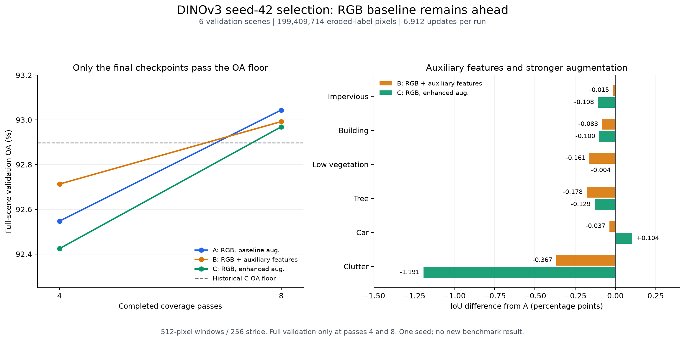

# DINOv3 RGB selection and seed-43 confirmation

**RGB baseline A won**, and **D confirmed A with seed 43**. Each arm ran eight
passes (6,912 updates) and cleared the four historical C floors on 199,409,714
validation pixels. Horizontal flips fell short of the 0.1-point OA gain required
for both seeds. The selection lock kept identity inference.

See the [protocol](potsdam-dinov3-rgbir-v2.md),
[preflight](potsdam-dinov3-rgbir-v2-preflight-2026-11-05.md), [A
review](potsdam-dinov3-rgbir-v2-selection-review-2026-11-05.md) and [A/B
review](potsdam-dinov3-rgbir-v2-selection-review-2026-11-06.md).

## Results and interpretation

The table uses selected checkpoints at update 6,912. Full-scene validation uses
512 × 512 windows, stride 256 and eroded labels.

| Configuration | OA | Six-class mIoU | Car IoU | Clutter IoU |
| --- | ---: | ---: | ---: | ---: |
| Historical C seed-42 reference | 92.8978% | 79.5643% | 92.9585% | 38.9751% |
| **A: RGB, baseline augmentation** | **93.0441%** | **80.7498%** | 93.9552% | **43.8339%** |
| B: RGB + IR/index/DSM auxiliary branch | 92.9923% | 80.6097% | 93.9180% | 43.4670% |
| C: A's RGB recipe, enhanced augmentation | 92.9690% | 80.5115% | **94.0595%** | 42.6426% |
| C minus A, percentage points | -0.0750 | -0.2382 | +0.1043 | -1.1913 |
| D: A's recipe, seed 43 confirmation | 92.9477% | 80.4596% | 93.7907% | 42.8664% |

The left panel shows full validations at passes 4 and 8; all arms move from below
the OA floor to above it. The right panel shows class IoU differences from A.
The [SciencePlots rendering](../figures.md#dinov3-reports) uses audited manifests
and class IoUs; its inputs are recorded with the external review artifacts.

C gains 0.1043 point in car IoU and loses 1.1913 points in clutter IoU. It makes
14,020,417 validation errors versus A's 13,870,767 (**149,650 more**). Under the
eight-pass schedule, the enhanced recipe scored lower in seed-42 OA and mIoU.

At pass eight, C's train mIoU is 83.0787% versus A's 83.1445%. Mean training
losses are 0.2344 and 0.2329 respectively. These measurements use each recipe's
own augmented batches.

All arms cover 2,592 base windows plus 432 draws per rare class each pass.
Augmentation yields 6,991,404,308 valid pixel presentations for C, 2,581,204
fewer (under 0.04%) than A/B.

## Confirmation and scoring gates

D repeats A from pretrained for eight passes. At the selected update 6,912, D
makes 14,062,959 validation errors. OA falls 0.0964 point and mIoU falls 0.2902
point versus A; both seeds clear all four floors.

Horizontal-flip TTA improves all four metrics for both checkpoints, but fails
the minimum OA-gain rule:

| Seed | Identity OA | Horizontal-flip OA | Gain, percentage points | Required |
| --- | ---: | ---: | ---: | ---: |
| 42 | 93.0441% | 93.1227% | +0.0786 | >=0.1000 |
| 43 | 92.9477% | 93.0167% | +0.0690 | >=0.1000 |

The frozen policy therefore remains **identity**, with 512x512 windows and
stride 256. The seed-42 checkpoint SHA-256 is
`fbc022c284b42ed0a4a9a25397e9fa502267b549b2c10164b8a0b196fad066fb`;
the confirmation checkpoint is
`7dc88b20879b950af86e0fb1665c9b790d1338530ea7306207ab46541c7c341a`.
The canonical selection-lock hash is
`6408c4737250c4bc0c0d27a28b6e325b4928ed38e7cfc49ec0a203c524d998b8`.
It fixes A's RGB/baseline-augmentation recipe, the selected seed-42 weights,
inference policy, half learning rates and exact 1,152-update refit. Only the
complete final checkpoint can open the single benchmark attempt. No selection
threshold or schedule was changed after observing the results.

## Accounting and audit

| Measurement | A | B | C | D |
| --- | ---: | ---: | ---: | ---: |
| Timed training, seconds | 4,301.9162 | 4,874.1140 | 4,355.6156 | 4,335.0447 |
| Timed validation, seconds | 542.1253 | 496.5227 | 394.4229 | 470.9911 |
| Validation / (train + validation) | 11.19% | 9.25% | 8.30% | 9.80% |
| Full allocated GPU-hours | 2.9335358 | 3.2024464 | 2.8305651 | 3.2084227 |

Preflight and A/B/C/D used **12.5675127 allocated GPU-hours** across both T4s.
D's total includes the 0.3278253 GPU-hour TTA run. C used 2.8271300 GPU-hours in
the worker and 2.8209043 in the inner runner. Validation timing includes probes,
full-scene scoring, input diagnostics and checkpoint writes.

The independent review verifies all four phase artifact inventories and
checkpoint hashes, all **134 saved train/probe/full-scene, TTA and per-scene
confusion matrices**, each arm's exposure sum, finite input panels and the
lock's seed/checkpoint/recipe bindings. There are 120 history matrices and 14
TTA matrices. D has 6,994,045,832 valid-pixel presentations. Its final 36-patch
input panel has no nonfinite values before or after normalization.
C's selected checkpoint SHA-256 is
`4d5bf3453a8466fb4d47869dd5066a1ffd677c05c2493561a16b51176eda6d58`.
The protocol remains
`db17701748df5596704e4da7f2b41d9f5c4d9cab0666e2475e81bfcdbd9edc7d`;
the source remains
`050ba61e3d018f643bf5c463e605f551da093f13172f287dba587a1d7c04d466`.

Primary weights/logs and derived analysis remain outside Git under
`/Users/macbook/Data/deepnet-for-semantic-labeling-photogrammetry/runs/potsdam-dinov3-rgbir-v2/`.
`study/C/`, `study/D/` and their `kaggle/` directories hold original outputs and
audits. `study/selection-lock.json` binds the decision; TTA matrices are retained
even though that policy was rejected. The directory
`review-selection-abc-20261106/` holds the ABC analysis, class/scene CSVs,
comparison PNG/PDF and their inventories. Only the small report PNG is copied
into Git, with identical bytes. `review-confirmation-20261106/` adds the
independent confirmation/TTA analysis, comparison CSV and inventory. Historical
artifacts are unchanged.
