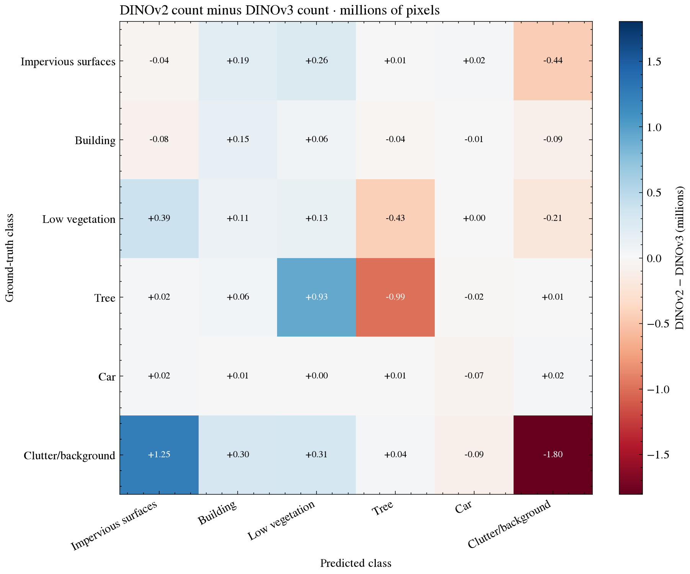

# DINOv2-to-DINOv3 error decomposition

## Scope

This analysis compares the historical DINOv2 and DINOv3 refit confusion matrices on the
same recorded 14-scene, 467,862,855-pixel Potsdam cohort. Each matrix uses truth classes
as rows and predicted classes as columns. The DINOv2 and DINOv3 recipes are different
systems; these counts do not attribute an effect to a single architecture or training
change.



*Figure 1. Each cell shows $D_{ij}/10^6$, where $D_{ij} = C_{\mathrm{DINOv2},ij} - C_{\mathrm{DINOv3},ij}$ is the difference in pixel counts. Positive
off-diagonal values mean fewer errors of that true/predicted class pair in DINOv3;
negative values mean more. The diagonal is the corresponding change in correct
predictions with the opposite error interpretation.*

## Net change

DINOv2 has 39,868,882 errors and DINOv3 has 37,243,220. The net reduction is 2,625,662
pixels, a 6.59% decrease from the DINOv2 error count. The diagonal true-positive change
in the matrix is exactly 2,625,662, so the OA increase is 0.5612 percentage points on
the shared recorded support.

| True class → prediction | DINOv2 errors | DINOv3 errors | Fewer errors in DINOv3 |
| --- | ---: | ---: | ---: |
| Clutter/background → impervious surfaces | 4,876,846 | 3,628,388 | 1,248,458 |
| Tree → low vegetation | 6,262,734 | 5,336,529 | 926,205 |
| Low vegetation → impervious surfaces | 2,899,494 | 2,510,302 | 389,192 |
| Clutter/background → low vegetation | 1,785,745 | 1,474,437 | 311,308 |
| Clutter/background → building | 1,785,745 | 1,482,519 | 303,226 |
| Impervious surfaces → low vegetation | 3,642,142 | 3,380,493 | 261,649 |

The matrix-level CSV contains every class transition and exact counts; the table above
highlights the largest reductions. In particular, the combined tree↔low-vegetation
error count falls by 501,204, because 926,205 tree→low-vegetation errors are reduced
while low-vegetation→tree errors increase by 425,001. Clutter→impervious contributes
1,248,458 fewer errors. Together these two grouped patterns account for 1,749,662,
about 66.6% of the net error reduction, after all other increases and decreases are
included.

Some confusion types increase in DINOv3. Impervious→clutter rises by 437,813,
low-vegetation→tree by 425,001, low-vegetation→clutter by 206,223, and clutter→car by
93,826. The signs matter: a positive number in the matrix is a reduction in that error
type; a negative number is an increase.

## Class-level changes

| Class | Support | TP change | FN change | FP change | Recall change (pp) | IoU change (pp) |
| --- | ---: | ---: | ---: | ---: | ---: | ---: |
| Impervious surfaces | 147,481,039 | +44,215 | −44,215 | −1,602,404 | +0.0300 | +0.9281 |
| Building | 116,645,471 | −154,505 | +154,505 | −669,087 | −0.1325 | +0.3995 |
| Low vegetation | 96,433,432 | −129,698 | +129,698 | −1,562,346 | −0.1345 | +1.0266 |
| Tree | 79,936,961 | +991,386 | −991,386 | +404,249 | +1.2402 | +0.7501 |
| Car | 7,445,584 | +69,726 | −69,726 | +99,278 | +0.9365 | −0.2816 |
| Clutter/background | 19,920,368 | +1,804,538 | −1,804,538 | +704,648 | +9.0588 | +6.0635 |

Clutter has the largest gain in true positives and recall, but also more false positives.
Car recall improves while precision falls by 1.1623 points; its IoU decreases by 0.2816
points. Building and low vegetation have slightly more false negatives, but substantial
false-positive reductions improve their IoU. These effects show why OA alone does not
describe the class trade-offs.

## Interpretation boundary

Confusion matrices identify changes in aggregate class transitions. They do not identify
which individual pixel decisions changed between the models. The reported “fewer errors”
are net counts for a confusion type, not paired corrections. The supplemental paired
prediction study compares DINOv3 with PSPNet; it does not turn the historical
DINOv2–DINOv3 matrix difference into a causal or same-pixel attribution.

Recompute the analysis with:

```bash
uv run --locked --extra notebooks python scripts/research/potsdam_empirical.py \
  --runs-root /path/to/runs
```

Source tables: [`difference matrix`](data/potsdam-error-difference-matrix.csv),
[`all confusion transitions`](data/potsdam-confusion-transitions.csv), and
[`per-class errors and metrics`](data/potsdam-per-class-error-changes.csv).
