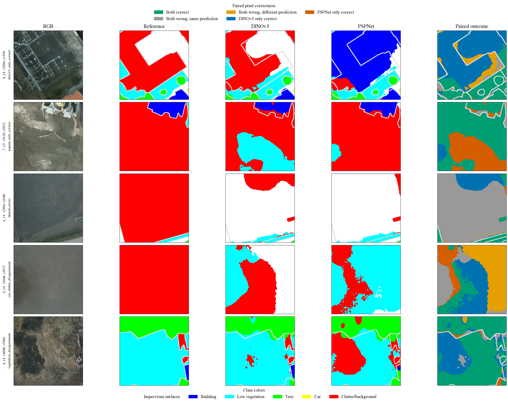
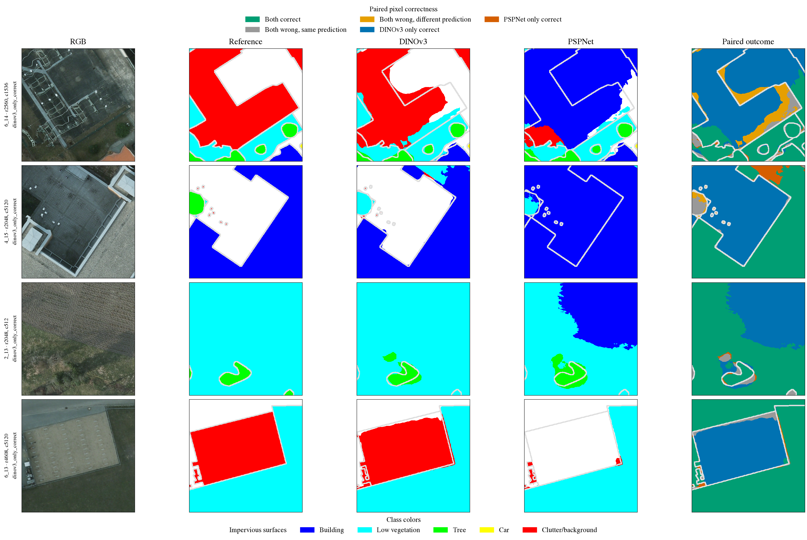
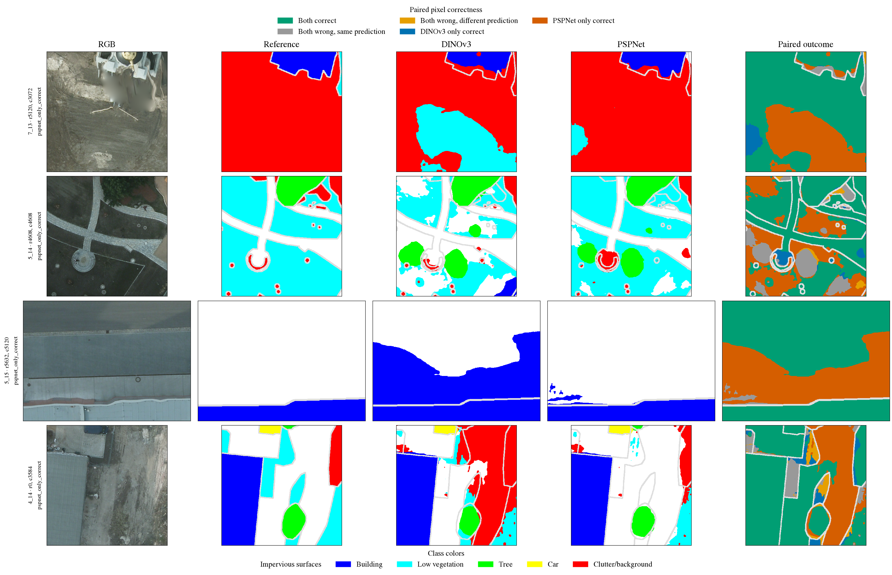
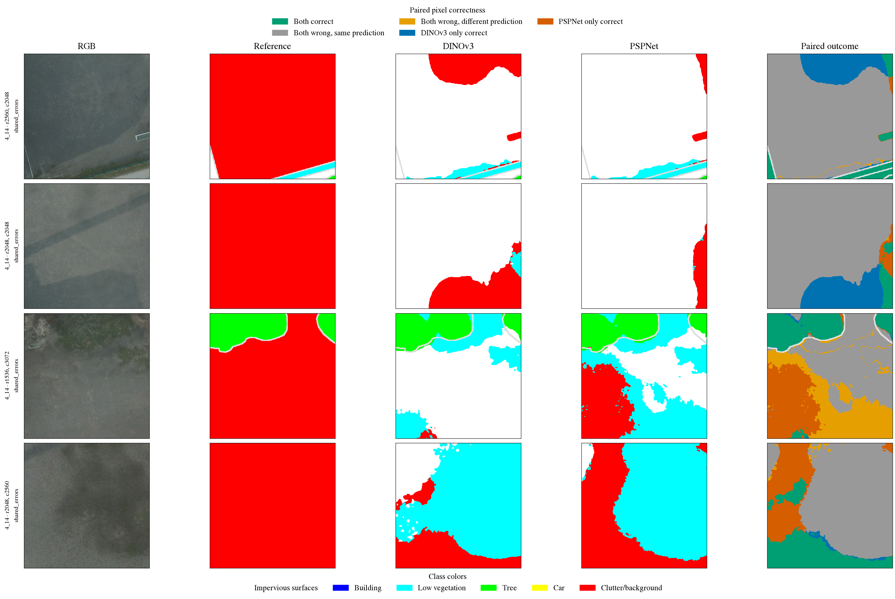
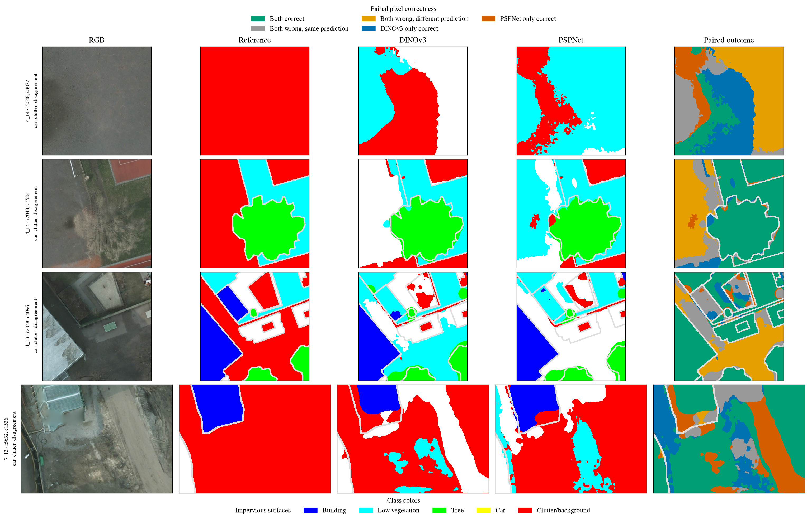
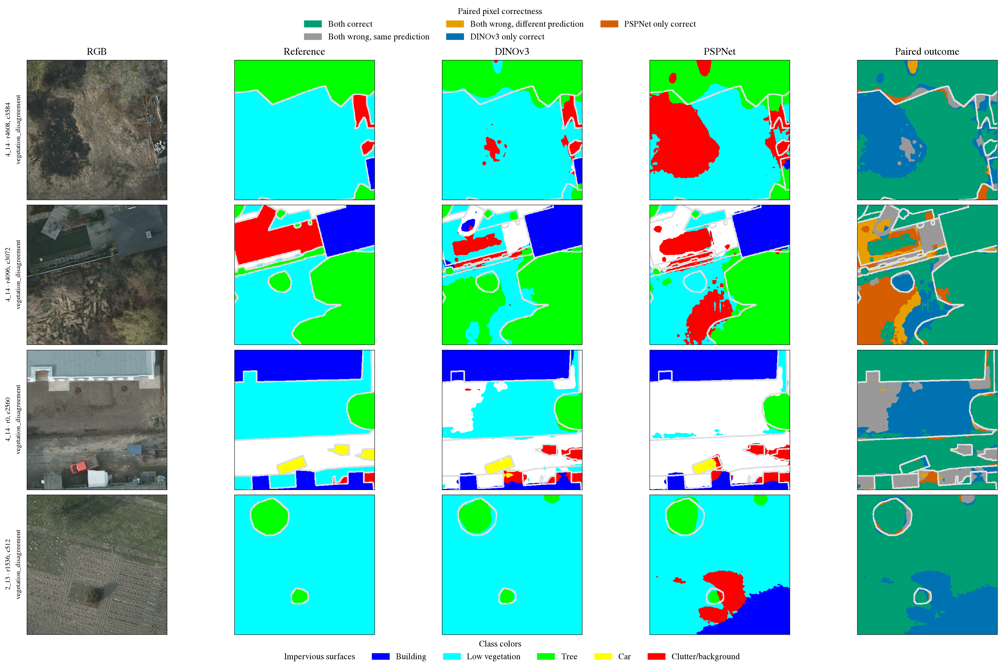

# Paired failures and representative Potsdam cases

## Evaluation scope and reproducibility gate

The paired study reruns inference only with the archived DINOv3-B RGB and PSPNet RGB
refit checkpoints. Both use the same test-only RGB cache (hash
`a8a376c9a7bd112cc4a0877f8aadcb6d7f1713fb0f39e60a5a29df548765cde4`), the same 14
scene IDs, eroded labels, 512×512 windows, stride 256, identity inference, and batch
size 4. No optimizer or training data was used.

The Kaggle job reproduced every archived per-scene confusion matrix for both models.
The local analysis then checked the downloaded output index and every prediction hash,
read the same held-out cache, and recomputed the scene and aggregate matrices. It
scored exactly 467,862,855 pixels. The original benchmark artifacts and metric files
were not changed. This is a paired analysis of the previously observed benchmark
cohort, not a new independent test.

## Pixel-level decisions

| Paired outcome | Pixels | Share of scored pixels |
| --- | ---: | ---: |
| Both correct | 417,385,769 | 89.21% |
| Both wrong | 27,547,977 | 5.89% |
| DINOv3 correct, PSPNet wrong | 13,233,866 | 2.83% |
| PSPNet correct, DINOv3 wrong | 9,695,243 | 2.07% |
| Predictions agree | 442,185,032 | 94.51% |
| Predictions disagree | 25,677,823 | 5.49% |

The four correctness states partition the scored pixels. DINOv3 corrects 3,538,623
more pixels than it loses relative to PSPNet. This equals the difference in the two
models' total correct-pixel counts and reproduces the 0.7563-point OA gap. Of the
27,547,977 pixels both models classify incorrectly, 24,799,263 receive the same wrong
label and 2,748,714 receive different wrong labels.

These counts show that the systems agree on most pixels, while DINOv3's net advantage
comes from the balance of corrections and introduced errors on the pixels where their
correctness differs. They do not identify why a pixel is ambiguous or prove an
architectural cause.

## Class-level corrections and introduced errors

| Ground-truth class | DINOv3-only correct | PSPNet-only correct | Net DINOv3 correct pixels |
| --- | ---: | ---: | ---: |
| Impervious surfaces | 3,090,122 | 2,800,636 | +289,486 |
| Building | 977,764 | 1,104,619 | −126,855 |
| Low vegetation | 4,008,734 | 2,621,074 | +1,387,660 |
| Tree | 2,724,738 | 2,037,333 | +687,405 |
| Car | 43,577 | 45,187 | −1,610 |
| Clutter/background | 2,388,931 | 1,086,394 | +1,302,537 |

The largest net class-level correctness gains occur for low vegetation and
clutter/background. The paired tree/low-vegetation transitions also favor DINOv3:
DINOv3 is correct where PSPNet predicts the other vegetation class on 3,799,265 pixels;
PSPNet is correct where DINOv3 predicts the other vegetation class on 3,009,816
pixels. The net difference for these two opposite confusion directions is 789,449
pixels.

Building and car have slightly more PSPNet-only correct pixels in the paired map, even
though DINOv3's aggregate IoU is higher for both classes. IoU also depends on false
positive predictions from other true classes; paired correctness within the ground-truth
class alone does not describe the full IoU denominator. Full class IoU and
prediction-confusion changes are in
[`paired-class-transitions.csv`](data/paired-class-transitions.csv) and
[`paired-correction-confusions.csv`](data/paired-correction-confusions.csv).

## Failure-mode taxonomy

The taxonomy below is descriptive and limited to the eroded reference and the two
prediction maps.

| Observed pattern | Evidence | Scope of interpretation |
| --- | --- | --- |
| Shared semantic errors | 27.55 million pixels are wrong for both systems; 24.80 million share the same predicted class. | Indicates many errors are common to the two tested systems. It does not identify the missing signal or a common cause. |
| Vegetation confusion | Tree↔low-vegetation accounts for the largest paired correction transitions; DINOv3 has 789,449 more correct pixels across these two transition directions. | Measured class decisions only; not evidence that spectral ambiguity caused them. |
| Clutter/background | DINOv3 has 1,302,537 more paired correct pixels for this ground-truth class, and its historical IoU is higher. | The class aggregates heterogeneous objects. The labels do not establish which clutter subtypes are responsible. |
| Car pixels | PSPNet has 1,610 more paired correct car pixels, while the aggregate DINOv3 car IoU is higher. | Pixel counts do not establish object detection, object completeness, or occlusion robustness. |
| Boundary behavior | The displayed reference is eroded. | No conclusion about full-reference boundary accuracy is supported. |
| Context, sensor, or radiometric effects | No paired intervention changes context, sensor, channels, or radiometry. | These mechanisms remain untested hypotheses. |

## Deterministic visual cases

Twenty non-overlapping grid crops, each at most 512×512 pixels, were selected by pixel
counts before looking at the images: four crops with the largest DINOv3-only correctness, four with the
largest PSPNet-only correctness, four with the most shared errors, four with the most
car/clutter prediction disagreement, and four with the most tree/low-vegetation
disagreement. Ties are resolved by scene ID and row/column order. The selection recipe
and per-crop counts are saved in [`paired-case-studies.csv`](data/paired-case-studies.csv).
The joint true-class/DINOv3/PSPNet counts for every selected crop are in
[`paired-case-confusions.csv`](data/paired-case-confusions.csv).

Each panel shows RGB, eroded reference, DINOv3, PSPNet, and paired pixel correctness.
Gray regions in the prediction maps are excluded from scoring. The case selection is
for descriptive review only; it was not used for training, tuning, or checkpoint
selection.

The five rows below summarize the highest-scoring crop in each selection group. The
observations come from the scored reference and prediction maps, not from visual
impression alone. The final column gives a possible interpretation only to make the
next research question explicit; none of these mechanisms was tested by this study.

| Case and crop | Measured observation | Possible explanation to test; not established |
| --- | --- | --- |
| DINOv3-only, `6_14` at `(2560, 1536)`, 241,743 valid pixels | DINOv3-only correct: 148,625; PSPNet-only correct: 811. The reference is mainly clutter/background (120,567) and impervious surfaces (70,799). PSPNet predicts building on 172,800 pixels, including 102,931 reference clutter pixels and 58,860 impervious pixels. | Local texture or broader scene context may affect the building-versus-surface decisions. The current measurements do not separate those factors. |
| PSPNet-only, `7_13` at `(5120, 3072)`, 257,636 valid pixels | PSPNet-only correct: 79,348; DINOv3-only correct: 7,567. The reference is clutter/background on 233,574 pixels. DINOv3 predicts low vegetation on 76,378 of those pixels; PSPNet predicts clutter/background on 230,001 pixels overall. | Appearance overlap between clutter and low vegetation is one possible source of the local difference. There is no subtype annotation or controlled appearance test here. |
| Shared errors, `4_14` at `(2560, 2048)`, 258,486 valid pixels | Both models are wrong on 209,788 pixels. The reference is clutter/background on 249,408 pixels. DINOv3 predicts impervious surfaces for 204,107 of those clutter pixels and PSPNet for 235,781; both make that same wrong prediction on 202,154 pixels. | A shared appearance or label ambiguity may be involved, but the paired predictions alone cannot identify a common cause. |
| Car/clutter disagreement group, `4_14` at `(2048, 3072)`, 262,144 valid pixels | This selected crop contains clutter/background in all 262,144 reference pixels and no car pixels. DINOv3 predicts clutter on 103,765 pixels, impervious on 93,552, and low vegetation on 64,827; PSPNet predicts low vegetation on 191,845 and clutter on 64,059. The models disagree on 187,082 pixels. | The disagreement may reflect the heterogeneous clutter class or local appearance, but this crop has no object-subtype labels to verify that interpretation. This is a clutter example selected by the car/clutter disagreement rule, not a car case. |
| Vegetation disagreement, `4_14` at `(4608, 3584)`, 252,851 valid pixels | The reference contains 176,294 low-vegetation and 67,947 tree pixels. The models disagree on these vegetation pixels 66,991 times. PSPNet predicts clutter for 60,263 low-vegetation pixels; DINOv3 does so for 4,427. DINOv3-only correct: 64,716; PSPNet-only correct: 3,712. | Differences in texture, spectral response, or context may affect vegetation decisions. The present analysis does not distinguish among them. |

All five examples use eroded reference labels. The measurements therefore describe
only scored interior pixels and cannot establish full-boundary behavior. Hypotheses
about appearance, context, and class ambiguity are prompts for controlled experiments,
not findings about the cause of any individual prediction.

The overview contains the highest-count crop from each group. Detailed panels below
show all 20 selected cases.



### DINOv3-only correct pixels



### PSPNet-only correct pixels



### Shared errors



### Car and clutter disagreement



### Tree and low-vegetation disagreement



The images support inspection of where the two systems differ. They do not reveal
unlabeled ground truth, prove a semantic mechanism, or remove the benchmark's historical
reuse. Because the reference is eroded, apparent agreement or disagreement near class
boundaries must not be described as full-boundary accuracy.

## Reproduction

Download the verified Kaggle output, retain the external held-out cache and original
run artifacts, then regenerate the paired tables and figures:

```bash
uv run --locked --extra notebooks python scripts/research/paired_analysis.py \
  --kaggle-output /path/to/attempt-3/outputs \
  --cache /path/to/potsdam-dinov3-rgbir-v2/heldout-cache \
  --runs-root /path/to/runs \
  --output-dir docs/research
```
