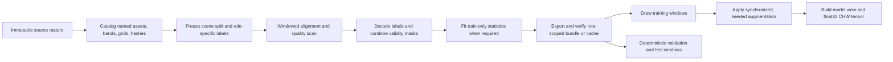

# Data Preparation and Augmentation for ISPRS Potsdam and Vaihingen

**Technical report** **Date:** 7 November 2026 **Scope:** Source imagery and labels, quality control, raster alignment, label decoding, normalization, window sampling, augmentation, and reproducibility before semantic segmentation training.

## Abstract

This report documents the repository's data preparation path for ISPRS Potsdam and Vaihingen. It focuses on the point at which immutable source rasters become verified scene records, training patches, and model-ready tensors. The workflow is built around named raster bands, frozen scene splits, explicit masks, deterministic label decoding, train-only fitted statistics, and versioned augmentation recipes.

The two datasets share the six-class ISPRS ontology but do not have interchangeable channel semantics. The local Vaihingen imagery is NIR/R/G. Potsdam's historical three-band files are labeled IRRG in the project catalog, but a source audit found that they correspond to verified RGBIR bands 4/2/3 (NIR/G/B). Newer Potsdam RGBIR data are separately verified in R/G/B/IR order. This difference must remain explicit when constructing a joint model input.

The report describes both the generic IRRG pipeline and the separate Potsdam RGBIR/DSM cache pipeline. These are different preparation paths. Several joint-training JSON configurations are marked `configured-not-trained`; their settings are not evidence that those recipes were executed. The completed RGBIR campaign is separately documented in its runbook.

## 1. Preparation pipeline at a glance

The key boundary is the frozen split. Scene membership is decided before patch generation, class-aware indexing, fitted statistics, or augmentation. Validation and held-out test data are not inputs to training-time fitting or stochastic augmentation.

## 2. Sources, channel identity, and roles

### 2.1 Optical inputs

| Dataset/view | Source channel order | Preparation consequence |
| --- | --- | --- |
| Vaihingen three-band orthophoto | NIR, red, green | The project model view exposes `ir`, `red`, `green`; scale the uint8 values to `[0, 1]` for the configured IRRG input. |
| Historical Potsdam three-band files | Source audit: RGBIR bands 4/2/3 = NIR, green, blue | The historical catalog names are `ir`, `red`, `green`, but the latter two names do not describe the audited source values. Preserve the historical mapping and record the discrepancy; do not silently reinterpret the bands. |
| Verified Potsdam four-band RGBIR snapshot | Red, green, blue, NIR | Use bands 1/2/3 for the RGB encoder path and band 4 for infrared features. Its verified manifest binds the source archive and raster hashes. |

The current generic `isprs-irrg-unit-v1` model input maps the catalog's named `irrg` bands to `ir/red/green` and divides each by 255. That is a valid numeric conversion, but it does not repair a semantic band mismatch in historical Potsdam files. A cross-dataset experiment should either use harmonized, source-verified bands or document that the channel names have different physical meanings by domain. The RGBIR path avoids the historical naming problem by checking the four-band source independently.

The locally prepared Vaihingen catalog contains the official three-band imagery and labels; it does not contain a locally verified, aligned DSM equivalent to the Potsdam RGBIR campaign's DSM source. Do not create a joint elevation view by filling that absence with an unverified product.

### 2.2 Labels and split roles

Current split manifests define 18/6/14 Potsdam scenes and 12/4/17 Vaihingen scenes for train, validation, and test. The split unit is a scene, not a geographically separated region. In both manifests, training uses participant labels; validation and test use eroded/no-boundary references. The black no-boundary pixels are ignored, so reported validation/test support is smaller than the full image footprint.

| ID | ISPRS class | Palette RGB | Use in training |
| ---: | --- | --- | --- |
| 0 | Impervious surfaces | `(255, 255, 255)` | Semantic target |
| 1 | Building | `(0, 0, 255)` | Semantic target |
| 2 | Low vegetation | `(0, 255, 255)` | Semantic target |
| 3 | Tree | `(0, 255, 0)` | Semantic target |
| 4 | Car | `(255, 255, 0)` | Semantic target; low-frequency class |
| 5 | Clutter/background | `(255, 0, 0)` | Semantic target; low-frequency class |
| 6 | Ignore / no-boundary | `(0, 0, 0)` | Excluded from loss and scoring |

Canonical preprocessing converts the RGB palette into integer IDs. Version 2 permits a unique nearest-palette match within 80 Euclidean RGB levels for color-managed label rasters; tied nearest colors and colors outside tolerance fail. Raster labels are categorical and use nearest-neighbor resampling. Unknown valid colors should be investigated at source rather than assigned to a class by guesswork.

## 3. Ingestion, alignment, and quality control

Raw rasters are treated as immutable inputs. A catalog records safe data-root-relative paths, band names, raster dimensions, data type, NoData, grid metadata, alignment evidence, and optional SHA-256 hashes. For georeferenced assets, the pipeline requires matching CRS and affine grids or an explicitly enabled reprojection path. For pixel-local image/label pairs without georeferencing, the catalog must retain source-attested pair evidence. Equal width and height alone is not proof of registration.

Quality reports scan bounded raster windows rather than loading full scenes. For each required model view, the reader checks the image and selected label asset against the scene reference grid. It intersects the label raster mask with all required image masks and finite-value masks. The report records valid coverage, class counts, ignored-label counts, and scored pixels by scene and split. This distinguishes three conditions that must not be collapsed: semantic ignore pixels, image NoData/invalid pixels, and valid semantic pixels.

For on-grid reads, Rasterio returns the requested window and raster mask. If explicit reprojection is allowed, continuous data use the requested continuous resampler (bilinear in the canonical preprocessing spec); categorical labels use nearest-neighbor. Out-of-scene patch edges are constant-padded and marked invalid. Invalid image values are zeroed only after their masks have been retained, so zero remains a storage value and is not treated as a valid observation.

Recommended preparation sequence:

1. Materialize the intended, versioned source snapshot and keep the source tree read-only.
2. Build a catalog with hashes where source identity must be auditable.
3. Load the frozen split manifest and select its role-specific label asset.
4. Run quality validation over each selected input view; investigate alignment, palette, mask, or finite-value failures before exporting a bundle.
5. Fit any required normalization statistics using training scenes only.
6. Export a train/validation bundle for model selection. Create a separate train-only refit bundle or held-out benchmark cache only when the experiment protocol requires it.
7. Verify the resulting artifact hashes and scene/role inventory before training.

The repository's command examples and data contracts are in the [data pipeline guide](../data-pipeline.md) and [data invariants](../invariants.md).

## 4. Model views and normalization

Normalization is part of the model-input contract, not a universal preprocessing constant. `apply_model_view` selects source bands by name, applies the configured rule, masks invalid values to zero, and returns a contiguous float32 tensor in the configured layout (the current generic view uses CHW).

| Input type | Configured operation | Scope and note |
| --- | --- | --- |
| Generic IRRG optical bands | Divide uint8 source values by 255 | Produces `[0, 1]` inputs; the learned spectral adapter then maps sensor bands to the pretrained encoder's RGB space. |
| A z-score view | Subtract training mean and divide by population standard deviation | Statistics are streamed over valid, finite pixels from training scenes only. The preprocessing artifact records fitted scene IDs and the exact split hash. |
| Potsdam RGBIR optical cache | Convert the four uint8 bands to `[0, 1]` at sample-read time | The verified cache stores source RGBIR as uint8; the model view chooses RGB only or RGB plus infrared/features. |
| Potsdam relief feature | Local DSM relief divided by a training-fitted absolute p99 scale and clipped to `[-1, 1]` | Separate from optical normalization. A DSM availability channel records missing elevation independently of image/label validity. |

The statistics fitter uses valid pixels and rejects non-training scene IDs, empty channels, non-finite or zero standard deviations, mismatched grids, and missing channel sources. Refit phases must preserve their declared fit scope; for the RGBIR refit, the 24-scene train-only cache uses relief scale fitted on the original 18 training scenes rather than refitting on the former validation scenes. This keeps the feature scale fixed across selection and refit.

Potsdam DSM preparation uses the versioned `valid-box-101-p99abs-stride16-v1` recipe: local relief is derived by subtracting a valid 101 × 101 neighborhood mean, scaled by the absolute p99 computed from original training scenes, and clipped. Missing DSM cells get zero relief and zero availability; they do not become invalid image pixels or disappear from the scoring mask. The JPEG nDSM is excluded because its decoding and co-registration are not verified. Source vertical units and datum also remain unconfirmed, so relief is a normalized local feature rather than a claim of verified absolute elevation.

## 5. Patch construction and sampling

### 5.1 Generic IRRG training

The generic `ScenePatchDataset` accepts training scenes only. It draws a scene and a fixed-size crop, then derives a deterministic sample RNG from `(seed, epoch, index)`. Uniform sampling chooses scenes and valid top-left crop positions. The optional class-aware index is built from training labels only, rejects any non-training scene, and selects a window containing a sampled class pixel.

The joint IRRG configuration uses a 30% class-aware component and 70% uniform component. Class frequencies are converted into bounded inverse-square-root class weights (clamped to 0.5–2.0); class sampling and class weights are derived from training counts, never validation/test labels. Potsdam and Vaihingen receive equal domain sampling weight in the joint schedule. The effective crop size is model-patch aware: the DINOv2 config uses 504 × 504 for Potsdam and 280 × 280 for Vaihingen (multiples of ViT-B/14's 14-pixel patch); the configured DINOv3 joint recipe uses 512 × 512 and 288 × 288 (multiples of ViT-B/16's 16-pixel patch).

Validation uses deterministic full-grid windows with constant-padded edges and valid masks. It has no stochastic augmentation. Test scenes are held outside selection bundles and are only read after checkpoint selection under the relevant frozen evaluation protocol.

### 5.2 Specialized RGBIR training

The Potsdam RGBIR study indexes the full training grid in 512 × 512 windows, then adds equal rare-class quotas for class 4 (car) and class 5 (clutter/background). In the documented selection pass, 2,592 base windows are supplemented by 432 car-centered and 432 clutter-centered windows. Each extra crop is centered near a sampled target-class pixel with up to 96 pixels of jitter. The draw list is deterministically shuffled, and each sample seed is derived from the study seed, pass number, and draw ordinal.

This policy increases rare-class exposure but does not make the training distribution naturally balanced. The training log should count the labels that actually reach the model after augmentation, separating semantic, ignored, and invalid pixels. The repository includes a histogram accumulator for this purpose. Keep source coverage statistics separate from post-augmentation presentation statistics.

## 6. Augmentation policies

Augmentation is applied only to training samples. Geometry must be synchronized across every continuous image band, auxiliary feature, label map, and validity mask. Continuous values use linear interpolation; categorical labels and masks use nearest-neighbor interpolation. Pixels created outside source support receive ignore labels and remain invalid.

### 6.1 Generic IRRG Albumentations recipes

Both recipes apply square symmetry (the eight rotations/reflections of a square) and then the configured affine operation. Affine uses linear image interpolation, nearest-neighbor label interpolation, constant-zero image fill, and ignore ID 6 for label fill. Radiometric operations apply only to optical channels; the IRRG multispectral data do not receive RGB hue/saturation changes. Auxiliary channels receive synchronized geometry but not optical brightness/gamma/noise/blur transforms.

| Setting | `isprs-irrg-aerial-v2` | `isprs-irrg-aerial-v3` |
| --- | --- | --- |
| Affine probability | 0.35 | 0.25 |
| Scale | 0.90–1.10 | 0.95–1.05 |
| Rotation | ±12° | ±6° |
| Translation | ±4% of window | ±2% of window |
| Brightness/contrast | p = 0.35; brightness ±0.08, contrast ±0.10 | Same |
| Gamma | p = 0.20; 90–110% | p = 0.20; 90–110% |
| Gaussian noise | p = 0.15; per-channel std 0.005–0.025, mean −0.005–0.005 on `[0,1]` scale | Same |
| Gaussian blur | p = 0.10; 3–5 pixel kernel | Same |

The generic augmenter receives aligned source values before model-view scaling. It temporarily maps optical values into their declared `[0, 1]` radiometric range for photometric transforms, clips there, and maps them back to the declared source range. Every transform has an independent deterministic random stream derived from the sample seed, so replay is stable and probability gates are not coupled to worker order.

There is a material version distinction. A repository audit found that v2 photometric transforms changed invalid affine-fill values in 30% of tested Potsdam trials and 25% of Vaihingen trials; two low-density Potsdam car crops lost all car pixels during affine stress replays. Version 3 preserves pre-radiometry values wherever the validity mask is false and reduces affine strength. In the focused v3 replay, the invalid fill stayed unchanged and every source-present car/clutter class remained represented across 80 trials. This is useful regression evidence, but the sampled crop audit is not a guarantee for every scene/window.

The current joint DINOv3 JSON configurations still select the v2 augmentation and are marked `configured-not-trained`. The DINOv2 joint JSON also records `configured-not-trained` while selecting v3; the completed historical DINOv2 run has a separate artifact review. Before a new run, bind the chosen augmentation version into the protocol, confirm the run manifest's configuration hash, and run the relevant augmentation audit. Do not infer the recipe used by a historical run from a later JSON file.

### 6.2 Potsdam RGBIR custom recipes

The RGBIR campaign uses a separate OpenCV augmenter rather than the generic Albumentations recipe. Every draw receives a random right-angle rotation and horizontal flip (D4 symmetry). Baseline affine probability is 0.25 with rotation ±6°, scale 0.95–1.05, translation ±2%, and a 96-pixel source halo. The augmenter reads context around each requested crop before affine warping. Optical values are already on a `[0, 1]` scale in the cache. Optical warps are normalized by warped valid support; labels and masks use nearest-neighbor; relief is warped only over available DSM support; unavailable relief stays zero.

The baseline radiometric operation applies a shared gain to optical channels with p = 0.25 and range 0.95–1.05. Baseline gamma, Gaussian noise, and DSM dropout are disabled. The enhanced recipe increases affine/gain strength and optionally enables gamma, noise, and DSM dropout, but the selected campaign arm used the RGB-only baseline recipe. For class-centered rare draws, affine is disabled so the transform does not crop the selected rare-class support away. When the auxiliary model view is used, the model computes the IR/red spectral index after optical augmentation; DSM relief and its availability mask remain distinct inputs.

## 7. Bundles, caches, and leakage controls

The generic bundle exporter copies only the assets needed by the declared model view and split roles. Its manifest binds catalog, split, preprocessing, model input, source revision, and file inventory hashes. A verified bundle must pass hash, shape, role, and content checks before the loader opens it.

The specialized RGBIR preparation creates separate artifacts for selection, refit, and benchmark phases. Per-scene memory-mapped arrays contain source optical data, relief, DSM availability, class IDs, and validity masks. The manifest binds source hashes, original and refit split hashes, label roles, feature recipe, feature scale, scene support, and each cached file's size and SHA-256. Selection contains the 18 train and six validation scenes; refit is a separate train-only cache with participant labels for that exact 24-scene union; benchmark data are separate and withheld until selection/refit gates are met.

Do not make patches first and split them later. This would allow neighboring crops from the same scene to cross split boundaries. The current scene splits are benchmark compatible but are not region-held-out; adjacent scenes may still be spatially related. Any stronger claim about geographic generalization needs a separate spatial-group split and a new fitted-statistics artifact.

## 8. Reproducibility and pre-training acceptance checks

| Check | Acceptance evidence |
| --- | --- |
| Source identity | Catalog paths stay inside the declared data root; band names, hashes, CRS/affine or source-pair evidence are recorded. |
| Scene-role isolation | Split manifest hash matches the protocol; no train/validation/test scene overlap; role selects participant or eroded label exactly as declared. |
| Grid and coverage | Every required asset aligns to the reference grid; quality scan reports mask intersection, finite-value coverage, class counts, and scored counts. |
| Label contract | Only IDs 0–5 are trainable classes; ID 6 is ignored; no unresolved valid RGB label colors remain. |
| Normalization | Fixed scaling or fitted statistics match the model-input spec; fitted statistics list only permitted train scenes and the split hash. |
| Sampling | Training indexes are train-only; effective crop dimensions match the model's patch size; observed post-augmentation class support is logged. |
| Augmentation | Geometry is synchronized; labels/masks use nearest interpolation; invalid/padded pixels remain invalid after photometric changes; sample seeds replay deterministically. |
| Cache/bundle | Artifact manifest verifies all source and derived file hashes, shapes, split roles, preprocessing contract, and feature recipe. |
| Evaluation isolation | Validation/test have deterministic full-grid sampling and no stochastic augmentation; held-out test input is not used for fitting or selection. |
| Provenance | Record config/protocol hashes, source and bundle/cache hashes, split hash, preprocessing/model-input/augmentation versions, seeds, and library/runtime versions. |

### Practical interpretation

For a standard three-band run, the main operational path is: catalog the scene-matched imagery and labels; validate alignment and label decoding; freeze the current scene split; generate train and validation bundles; run the train-only sampler with the declared class-aware fraction; augment aligned raw channels and labels; then scale the configured optical bands to `[0,1]` before the model adapter. For the specialized Potsdam RGBIR run, first build and verify the separate RGBIR and DSM snapshots and cache, then use the dedicated 512 × 512 coverage-plus-rare-class sampler and its mask-aware augmenter.

The key preparation risks are band-name/source mismatches, unverified elevation co-registration, ignoring the difference between label ignore and raster NoData, fitting statistics outside training scenes, and allowing photometric transforms to alter invalid padding. These are addressable before training and should be closed by catalog evidence, role-scoped artifacts, and augmentation replay rather than by visual inspection alone.

## 9. Repository references

- [Data pipeline guide](../data-pipeline.md)
- [Data and experiment invariants](../invariants.md)
- [Potsdam/Vaihingen data profile](potsdam-vaihingen-data-profile-2026-11-07.md)
- [Potsdam DINOv3 RGBIR campaign runbook](../experiments/potsdam-dinov3-rgbir-v2.md)
- [Potsdam DINOv2 selection/refit runbook](../experiments/potsdam-dinov2-coverage-refit.md)
- [Canonical preprocessing specification](../../configs/preprocessing/isprs-canonical-v2.json)
- [IRRG model-input specification](../../configs/model-inputs/isprs-irrg-unit-v1.json)
- [Generic IRRG augmentation v2](../../configs/augmentations/isprs-irrg-aerial-v2.json)
- [Generic IRRG augmentation v3](../../configs/augmentations/isprs-irrg-aerial-v3.json)
- [RGBIR training configuration](../../configs/training/potsdam-dinov3-rgbir-v2.json)
- [RGBIR preparation and cache code](../../deepnet/potsdam_rgbir/prepare.py)
- [Generic preprocessing code](../../deepnet/data/preprocessing.py)
- [Generic augmentation code](../../deepnet/data/augmentations.py)
- [Generic raster/window reader](../../deepnet/data/raster.py)
- [Generic train sampler](../../deepnet/data/sampling.py)
