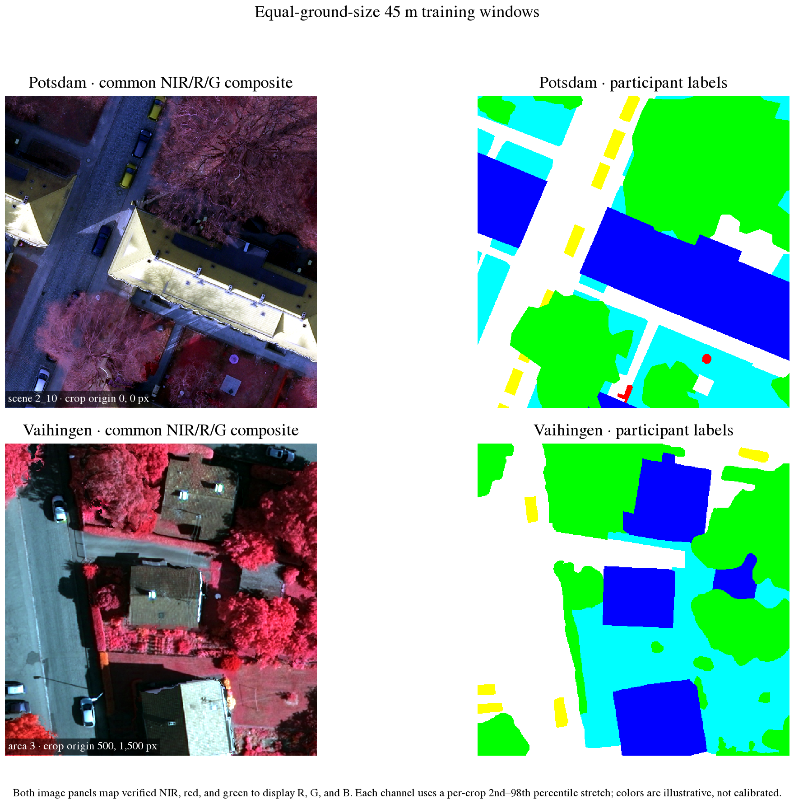
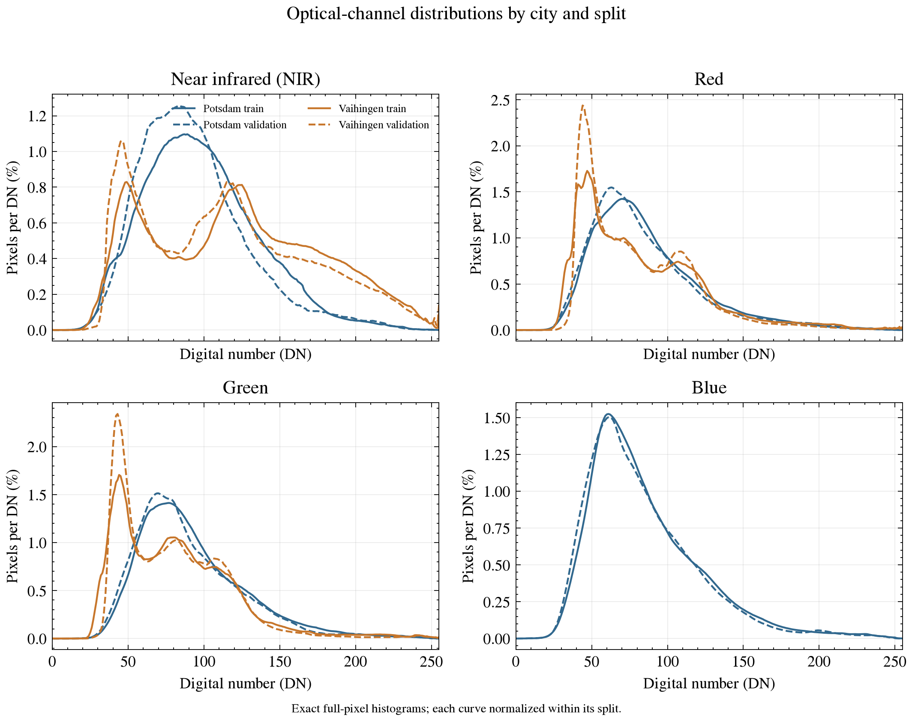
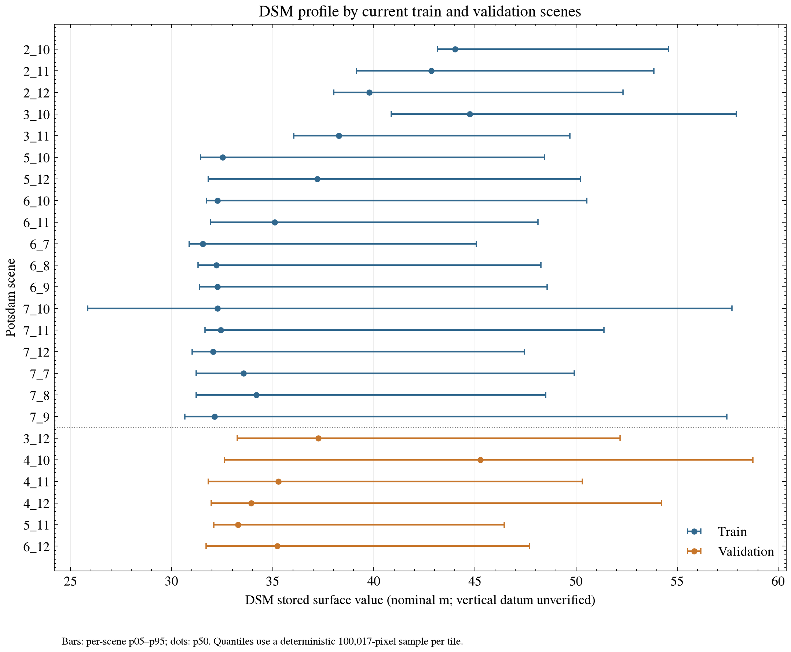
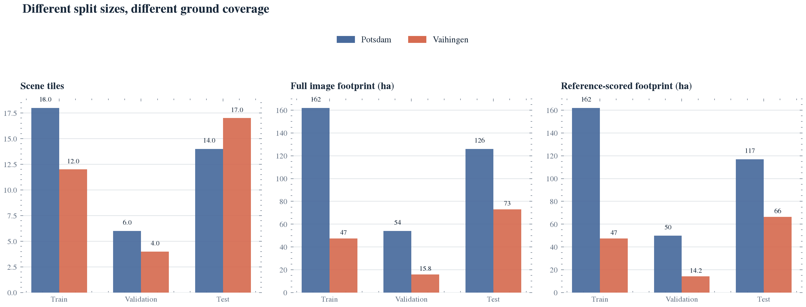
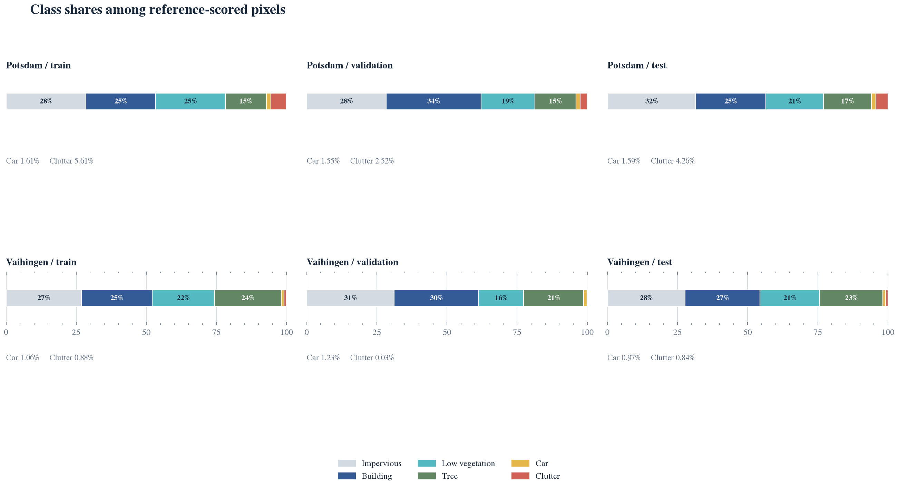
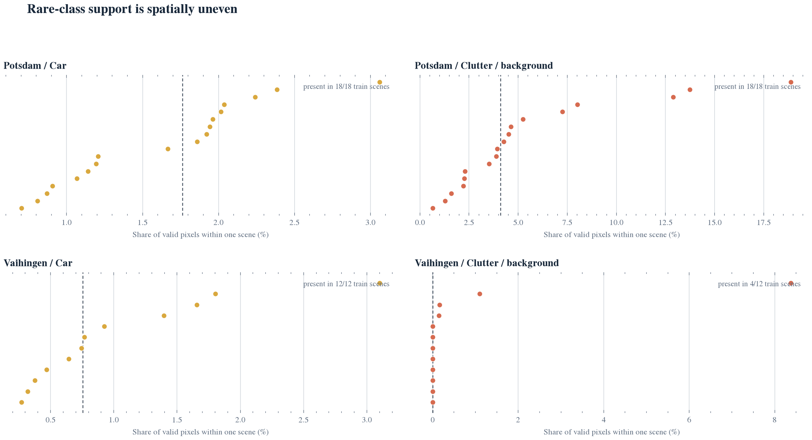
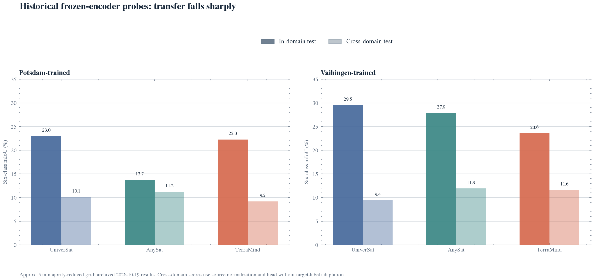

# Potsdam and Vaihingen: Data Profile for ISPRS Urban Semantic Segmentation

**Scientific data report** 
**Prepared:** 7 November 2026 
**Scope:** Local scene catalogs, verified optical channels, Potsdam DSM coverage, prepared split manifests, label composition, spatial support, and archived transfer evidence

## Abstract

Potsdam and Vaihingen share the ISPRS six-class urban labeling ontology, but their spatial sampling, scene geometry, class prevalence, optical channel mapping, and local modality coverage differ. One Vaihingen pixel covers 3.24 times the ground area of one Potsdam pixel; clutter/background represents 5.61% of Potsdam training labels and 0.88% of Vaihingen training labels; and Vaihingen clutter occurs in only 4 of 12 training scenes. A source-level audit also shows that the historic three-band Potsdam view maps to near infrared, green, and blue, while the official Vaihingen view is near infrared, red, and green. On the current training scenes, pooled NIR median is 95 DN for Potsdam and 121 DN for Vaihingen. These are uncalibrated image digital numbers, not reflectance measurements. The data support scene-aware sampling, explicit band routing, and ground-scale-aware evaluation; they do not establish that either dataset is intrinsically harder.

## 1. Introduction and scope

The ISPRS benchmarks provide very high resolution airborne orthophotos and six semantic classes. The official descriptions characterize Vaihingen as a smaller village with detached buildings and Potsdam as a denser historic city with larger blocks and narrow streets. The class ontology is shared, but the spatial context and sensing scale are not [ISPRS overview](https://www.isprs.org/resources/datasets/benchmarks/UrbanSemLab/semantic-labeling.aspx).

This report answers five descriptive questions:

1. How do local scene geometry, ground sampling distance, and prepared data coverage differ?
2. How do six-class label proportions differ across train, validation, and test roles?
3. Which minority classes are represented across scenes, rather than only in aggregate pixel counts?
4. What does the archived cross-domain evidence say about transfer between the two datasets?
5. How do the verified optical channels and locally available elevation data differ?

No model training or inference was run for this report. The current prepared manifests are the source for data counts. Archived experiments are included as qualified context and are not reinterpreted as fresh, untouched test results.

## 2. Data sources and acquisition geometry

| Property | Potsdam | Vaihingen |
|---|---|---|
| Official scene count | 38 | 33 |
| Ground sampling distance | 5 cm | 9 cm |
| Official tile geometry | 6,000 x 6,000 px; equal tiles of about 300 m x 300 m | Variable tile sizes; local area 3 is 3,007 x 2,006 px |
| Official optical products | RGB, IRRG, RGBIR | Three 8-bit bands: near infrared, red, green |
| Current three-band source mapping | The historic view is catalogued as IR/red/green, but the source audit maps it to RGBIR bands 4/2/3: NIR/green/blue | Official image order is NIR/red/green |
| Additional local modalities | Four-band RGBIR and DSM snapshots each contain 38 scenes | The official benchmark describes DSM products, but no DSM is present in the current local prepared catalog |
| Local geospatial metadata | Prepared Potsdam scenes record EPSG:32633 | The local Vaihingen catalog retains pixel-local pairing; CRS and affine fields are absent |
| Current split roles | 18 train / 6 validation / 14 test | 12 train / 4 validation / 17 test |

The official Potsdam page specifies 38 equal 6,000 x 6,000 pixel patches at 5 cm GSD, with RGB, IRRG, RGBIR and DSM products [ISPRS Potsdam](https://www.isprs.org/resources/datasets/benchmarks/UrbanSemLab/2d-sem-label-potsdam.aspx). The Vaihingen page specifies 33 different-sized patches at 9 cm GSD and three 8-bit image bands corresponding to near infrared, red and green [ISPRS Vaihingen](https://www.isprs.org/resources/datasets/benchmarks/UrbanSemLab/2d-sem-label-vaihingen.aspx).

The catalog's channel names are not sufficient evidence of spectral identity. The four-band Potsdam snapshot is ordered red, green, blue, infrared, and its source audit maps historical three-band values to bands 4/2/3 (NIR, green, blue), not the nominal NIR, red, green mapping. Vaihingen's official three-band source is NIR, red, green. The spectral analysis below therefore reads Potsdam from its verified four-band source and Vaihingen from its official three-band images.

The squared GSD ratio is `(9 / 5)^2 = 3.24`: a Vaihingen pixel covers 0.0081 m2, compared with 0.0025 m2 for a Potsdam pixel. Consequently, equal-sized pixel windows do not represent equal ground footprints. Patch sizes intended for cross-dataset comparison should be specified in metres and converted to pixels per dataset.

The figure below shows representative 45 m square training windows using the verified common NIR/red/green bands. Those bands are mapped to display red/green/blue to form a false-color composite. Each crop has its own 2nd-to-98th percentile display stretch; these colors are illustrative and are not calibrated reflectance values. The paired labels use the official six-class palette.

**Figure 1.** Representative training imagery and labels: Potsdam scene 2_10 and Vaihingen area 3. Both image panels use NIR/red/green in display RGB order. Each crop covers approximately 45 m x 45 m and was selected to include diverse labels.

## 3. Optical channels and radiometric profiles

The channel distributions were recomputed from the full current training and validation image grids: all four uint8 bands in Potsdam's verified RGBIR source and all three uint8 bands in Vaihingen's official NIR/red/green images. Current test scenes were excluded. The analysis therefore avoids carrying the old Potsdam channel names into a cross-dataset comparison.

| Dataset | Channel | Train mean ± SD (DN) | Train p05 / p50 / p95 (DN) | Train range of per-scene medians (DN) | Validation p50 (DN) |
|---|---|---:|---:|---:|---:|
| Potsdam | Red | 86.5 ± 35.7 | 42 / 79 / 159 | 70–84 | 76 |
| Potsdam | Green | 92.6 ± 35.3 | 48 / 85 / 161 | 78–91 | 82 |
| Potsdam | Blue | 85.5 ± 36.6 | 41 / 77 / 156 | 71–86 | 75 |
| Potsdam | Near infrared | 98.7 ± 37.2 | 44 / 95 / 165 | 79–119 | 88 |
| Vaihingen | Near infrared | 121.4 ± 55.0 | 41 / 121 / 216 | 98–150 | 112 |
| Vaihingen | Red | 82.0 ± 40.3 | 36 / 72 / 160 | 58–101 | 71 |
| Vaihingen | Green | 80.9 ± 38.5 | 35 / 76 / 149 | 61–97 | 74 |

Vaihingen's training NIR median is 26 DN above Potsdam's, and its NIR standard deviation is about 48% larger. In contrast, its red and green training medians are 7 and 9 DN lower. The scene-level median ranges overlap, so the pooled difference does not describe every tile. Validation medians are 1–9 DN below their training counterparts across the matched channels. These are descriptive shifts across only 6 Potsdam and 4 Vaihingen validation scenes, not independent pixel-level significance tests.

**Figure 2.** Exact uint8 digital-number histograms for the current train and validation scenes. Each curve is normalized within its dataset, role, and channel. The RGB bands are available only in the local Potsdam optical source; Vaihingen supplies NIR, red, and green.

The observed numbers are digital numbers rather than calibrated reflectance. Differences may reflect sensor response, acquisition, orthorectification, illumination, and scene composition as well as surface properties. The three-band inputs are not spectrally interchangeable: treating Potsdam's historic second/third channels as red/green would mislabel green/blue as red/green. Fit normalization on training data only and keep any cross-city comparison tied to source-verified bands.

## 4. Potsdam elevation and auxiliary-channel coverage

The local Potsdam DSM snapshot covers the current 18-scene training and 6-scene validation roles. All 24 selected tiles contain 36 million valid DSM pixels and pass the metadata grid comparison with their optical reference. The figure shows each scene's sampled p05–p95 interval and median. Median DSM values span 31.54–44.74 in training scenes and 33.28–45.28 in validation scenes.

**Figure 3.** Per-scene DSM p05–p95 intervals and medians for current training and validation scenes. Quantiles use a deterministic block-stratified sample of about 100,000 pixels per scene; mean, standard deviation, minimum, and maximum in the derived table use full valid grids. The x-axis uses nominal metres from the dataset configuration, but source vertical units and datum are not confirmed, so the values are not interpreted as absolute height.

The wider DSM inventory contains one grid exception: scene `3_13` is one column shorter than its optical reference, outside the current train/validation profile. The 38 configured nDSM JPEGs have a separate limitation: 37 share the optical image dimensions, but none contain CRS/affine metadata or verified registration evidence. Their values are encoded 8-bit digital numbers, not verified metric heights. The nDSM is therefore excluded from the channel figure and elevation interpretation. Vaihingen's official materials include elevation products, but no aligned Vaihingen DSM is present in the local prepared catalog, so this report cannot compare elevation distributions across cities.

The completed Potsdam DINOv3 selection also compared RGB-only model A against model B, which bundled infrared/index/DSM features. A achieved 93.0441% validation OA and 80.7498% mIoU; B achieved 92.9923% and 80.6097%. This single-seed validation comparison does not establish that each added channel is unhelpful: the extra signals were grouped in one arm and were not individually ablated.

## 5. Data preparation and split coverage

Catalog validation succeeds for all 38 Potsdam scenes and all 33 Vaihingen scenes. Train, validation, and test scene IDs are disjoint in the prepared split manifests. The split unit is a scene; the current split definition is not region-held-out.

Area estimates below are computed from image pixel dimensions and the official GSD. “Image area” counts all image pixels in a role. “Scored area” multiplies the count of class IDs 0-5 by the squared GSD; eroded reference boundaries with ignore ID 6 are excluded.

| Dataset | Role | Scenes | Scored pixels | Image area (ha) | Scored reference area (ha) | Ignored image share |
|---|---:|---:|---:|---:|---:|---:|
| Potsdam | Train | 18 | 648,000,000 | 162.00 | 162.00 | 0.00% |
| Potsdam | Validation | 6 | 199,409,714 | 54.00 | 49.85 | 7.68% |
| Potsdam | Test | 14 | 467,862,855 | 126.00 | 116.97 | 7.17% |
| Vaihingen | Train | 12 | 58,554,459 | 47.43 | 47.43 | 0.00% |
| Vaihingen | Validation | 4 | 17,591,104 | 15.82 | 14.25 | 9.94% |
| Vaihingen | Test | 17 | 81,991,943 | 73.06 | 66.41 | 9.10% |

**Figure 4.** Scene tiles, total image footprint, and reference-scored footprint by split. Pixel totals alone overstate the difference because Potsdam has finer sampling and larger test coverage.

Validation and test references use the official no-boundary/eroded labels. The ignored shares above are boundary pixels excluded from scoring, not missing imagery. Potsdam training uses participant labels, while validation and test use eroded references. Vaihingen follows the same role pattern in the prepared bundles. The label reference therefore changes by role and should remain visible in metric reporting.

The test image footprint is about 126 ha in Potsdam and 73.06 ha in Vaihingen. This makes the Potsdam test footprint 1.73 times larger by ground area, while its scored pixel count is 5.71 times larger. The gap between those ratios is largely explained by the different GSDs.

## 6. Label composition

The class IDs are 0 impervious surfaces, 1 buildings, 2 low vegetation, 3 trees, 4 cars, 5 clutter/background, and 6 ignored boundary. All proportions below use only valid class IDs 0-5.

| Class | Potsdam train | Potsdam validation | Potsdam test | Vaihingen train | Vaihingen validation | Vaihingen test |
|---|---:|---:|---:|---:|---:|---:|
| Impervious surfaces | 28.47% | 28.32% | 31.52% | 26.84% | 31.18% | 27.65% |
| Buildings | 24.88% | 33.80% | 24.93% | 25.20% | 30.09% | 26.77% |
| Low vegetation | 24.78% | 19.26% | 20.61% | 22.20% | 16.07% | 21.19% |
| Trees | 14.64% | 14.55% | 17.09% | 23.82% | 21.40% | 22.58% |
| Cars | 1.61% | 1.55% | 1.59% | 1.06% | 1.23% | 0.97% |
| Clutter/background | 5.61% | 2.52% | 4.26% | 0.88% | 0.03% | 0.84% |

**Figure 5.** Composition of scored pixels by class and split. The cars and clutter shares are called out below each bar because their small segments are difficult to compare visually at this scale.

The most pronounced train-set composition difference is clutter/background: its pixel share is 6.35 times higher in Potsdam than in Vaihingen. Car support is low in both datasets. Trees are more prevalent in Vaihingen training labels, at 23.82% versus 14.64% in Potsdam. Across the class proportions, the train-to-test total variation distance is 5.54 percentage points for Potsdam and 2.38 points for Vaihingen. This measure summarizes aggregate class mix but cannot describe scene location, label boundaries, or urban morphology.

## 7. Scene-level support for minority classes

Pixel totals obscure whether a rare class is spread across scenes or concentrated in a few locations. In Potsdam, cars and clutter are present in every training scene. In Vaihingen, cars are present in all 12 training scenes, but clutter appears in only 4 of 12. The same contrast persists in evaluation: clutter appears in 14 of 14 Potsdam test scenes but only 6 of 17 Vaihingen test scenes.

| Dataset | Role | Car-bearing scenes | Clutter-bearing scenes |
|---|---|---:|---:|
| Potsdam | Train | 18 / 18 | 18 / 18 |
| Potsdam | Validation | 6 / 6 | 6 / 6 |
| Potsdam | Test | 14 / 14 | 14 / 14 |
| Vaihingen | Train | 12 / 12 | 4 / 12 |
| Vaihingen | Validation | 4 / 4 | 1 / 4 |
| Vaihingen | Test | 17 / 17 | 6 / 17 |

**Figure 6.** Per-scene shares of valid pixels for cars and clutter/background in the training splits. The dashed line marks the median across scenes, including zero-support scenes.

The clutter/background category is heterogeneous by definition. ISPRS notes that it can include water bodies and other atypical objects such as containers, tennis courts, and swimming pools [ISPRS overview](https://www.isprs.org/resources/datasets/benchmarks/UrbanSemLab/semantic-labeling.aspx). In Vaihingen, its scarcity is both class imbalance and spatial concentration. A global inverse-frequency class weight cannot create missing visual contexts; sampling and validation should preserve scene-level support.

## 8. Archived transfer and model evidence

### 8.1 Frozen-encoder cross-domain probes

An archived 19 October 2026 study froze three pretrained encoders, fitted a linear segmentation head, and scored a majority-reduced grid of approximately 5 m per cell. Cross-domain evaluation used the source normalization and head without target-label adaptation. The scores below use the eroded reference [experiment report](../experiments/potsdam-vaihingen-foundation-probe-2026-10-19.md).

| Encoder | Potsdam in-domain mIoU | Potsdam-trained to Vaihingen mIoU | Vaihingen in-domain mIoU | Vaihingen-trained to Potsdam mIoU |
|---|---:|---:|---:|---:|
| UniverSat | 22.96% | 10.11% | 29.51% | 9.41% |
| AnySat | 13.73% | 11.23% | 27.86% | 11.91% |
| TerraMind | 22.28% | 9.20% | 23.56% | 11.59% |

**Figure 7.** In-domain held-out mIoU compared with transfer to the other city. This historical probe uses a coarse grid and is not directly comparable with full-resolution segmentation results.

All six transfer scores fall between 9.20% and 11.91% mIoU, below their in-domain scores. This is evidence of a substantial transfer gap under that probe protocol. It does not isolate the source of the gap: sensor scale, label support, neighborhood structure, and model-representation effects are entangled. The archived report explicitly requires a rerun under the current data pipeline.

### 8.2 Full-resolution joint DINOv2 run

A later historical joint DINOv2 run evaluated one selected model on both datasets. Its results provide a separate, higher-resolution reference point [final artifact review](../experiments/isprs-dinov2-joint-final-review-2026-11-01.md).

| Dataset / role | Scenes | Scored pixels | mIoU | Overall accuracy |
|---|---:|---:|---:|---:|
| Potsdam validation | 6 | 199,409,714 | 51.03% | 77.99% |
| Potsdam test | 14 | 467,862,855 | 48.65% | 74.66% |
| Vaihingen validation | 4 | 17,591,104 | 47.69% | 79.12% |
| Vaihingen test | 17 | 81,991,943 | 49.18% | 78.30% |

For that joint recipe, car IoU was 39.99% on Potsdam and 21.37% on Vaihingen; clutter IoU was 2.12% and 11.26%, respectively. These patterns do not follow class prevalence alone: Potsdam has more clutter labels but lower clutter IoU, while Vaihingen has lower car prevalence but lower car IoU. The comparison measures entire training and inference recipes, not an isolated dataset or backbone effect.

The latest audited DINOv3 benchmark in this repository is Potsdam-only, with 92.0397% OA and 81.0932% six-class mIoU on the historical 14-scene benchmark [DINOv3 final review](../experiments/potsdam-dinov3-rgbir-v2-final-review-2026-11-06.md). There is no matched DINOv3 Vaihingen evaluation in the reviewed artifacts. The DINOv3 result is not directly comparable with DINOv2 because model inputs, training recipe, refit, and inference policy differ; it also does not provide a cross-city comparison.

## 9. Discussion and recommendations

The profiles support five practical decisions for future joint experiments:

1. **Harmonize physical scale.** Declare crop width in metres and preserve a full-resolution evaluation alongside any common-ground-scale comparison.
2. **Sample by scene as well as class.** Track rare-class presence at scene and patch level. Ensure clutter appears in multiple Vaihingen scenes in training batches before tuning global class weights.
3. **Keep modality mappings explicit.** The three-band images are NIR/G/B in Potsdam and NIR/R/G in Vaihingen. Potsdam's additional RGBIR and local DSM sources have no matched, locally prepared Vaihingen equivalents; a joint modality experiment needs an explicit source and alignment policy.
4. **Report reference masks and support.** Keep full and no-boundary scores separate. Report ignore share, scored area, per-class IoU, scene-macro metrics, and class support.
5. **Reserve spatial regions.** Current splits are scene-level rather than region-held-out. Future claims about geographic generalization should group neighboring scenes before patch extraction.

## 10. Limitations

- Train, validation, and test roles have different scene counts and physical coverage in the two datasets.
- Training uses participant labels; validation and test use eroded references. Boundary removal changes the score denominator and can change class proportions.
- Aggregate class shares do not measure within-scene arrangement, object size, radiometry, or annotation ambiguity.
- Optical digital numbers are not calibrated reflectance, and the full-pixel histograms do not make neighboring pixels statistically independent. Validation represents only 6 Potsdam and 4 Vaihingen scenes.
- DSM vertical units and datum remain unverified. nDSM JPEG registration is unverified, and Vaihingen DSM data are absent from the local prepared catalog.
- The 2026-10-19 transfer probes predate the current contract-driven pipeline and operate on a coarse majority-reduced grid.
- The DINOv2 and DINOv3 results are historical observations and are not causal comparisons of dataset identity.
- Local Vaihingen catalog records are pixel-local and do not contain CRS/affine metadata. The local catalog `license_id` remains unverified; confirm source terms before redistributing source imagery or label crops.

## 11. Methods and data audit

Class proportions were computed as counts for IDs 0-5 divided by the sum of IDs 0-5. ID 6 is the ignored no-boundary label. Split areas were estimated as pixel count multiplied by squared official GSD; these are per-tile area sums, not a GIS union of scene footprints. Scene-level rare-class presence was determined from per-scene class counts in the quality manifests. The historical transfer table was read from the archived metrics JSON; no predictions were regenerated.

The current catalog checks report `valid` for both datasets. For every train, validation, and test role, aggregate class counts equal the sum of per-scene scored pixels. The class-share total variation between train and test is computed as one half of the L1 distance between the two six-class proportion vectors.

Optical channel histograms were counted over every pixel in the current Potsdam 18-scene training / 6-scene validation RGBIR grids and Vaihingen 12-scene training / 4-scene validation image grids. Potsdam's four channels were read in the verified RGB/IR order; Vaihingen uses the official IR/R/G order. Percentiles use the nearest-rank empirical definition. Current test scenes were excluded from the new channel files and figure. Each Potsdam DSM file in the current 18/6 roles was SHA-256 checked against the source inventory and scanned in native raster blocks; all 24 grids match their optical reference metadata. DSM p01–p99 are deterministic block-stratified sample estimates of about 100,000 pixels per tile; full-grid mean, standard deviation, minimum, and maximum are exact.

All seven visual figures were generated with Matplotlib using the **SciencePlots** `science` and `no-latex` styles. Figure 1 uses the verified common NIR/red/green composite; its per-crop contrast stretch is stated in the caption.

## 12. Sources

### Official dataset references

- [ISPRS Potsdam 2D semantic labeling dataset](https://www.isprs.org/resources/datasets/benchmarks/UrbanSemLab/2d-sem-label-potsdam.aspx)
- [ISPRS Vaihingen 2D semantic labeling dataset](https://www.isprs.org/resources/datasets/benchmarks/UrbanSemLab/2d-sem-label-vaihingen.aspx)
- [ISPRS semantic labeling overview and class definitions](https://www.isprs.org/resources/datasets/benchmarks/UrbanSemLab/semantic-labeling.aspx)

### Local data and experiment evidence

- [Potsdam train and validation quality manifest](../../data/prepared/potsdam/quality.json)
- [Potsdam test quality manifest](../../data/prepared/potsdam/post-selection-test-quality.json)
- [Vaihingen train and validation quality manifest](../../data/prepared/vaihingen/quality.json)
- [Vaihingen test quality manifest](../../data/prepared/vaihingen/post-selection-test-quality.json)
- [Potsdam verified RGBIR channel manifest](../../data/auxiliary/potsdam-rgbir-v2/rgbir_manifest.json)
- [Potsdam DSM source inventory](../../data/auxiliary/potsdam-dsm-v1/inventory.json)
- [Optical channel summary CSV](data/potsdam-vaihingen-optical-channel-statistics-2026-11-07.csv)
- [Exact optical channel histogram CSV](data/potsdam-vaihingen-optical-channel-histograms-2026-11-07.csv)
- [Potsdam train/validation DSM profile CSV](data/potsdam-dsm-train-validation-profile-2026-11-07.csv)
- [Data pipeline and channel provenance notes](../data-pipeline.md)
- [DINOv3 modality selection summary](../experiments/potsdam-dinov3-rgbir-v2-selection-summary-2026-11-06.md)
- [Potsdam and Vaihingen frozen-encoder probe](../experiments/potsdam-vaihingen-foundation-probe-2026-10-19.md)
- [Joint DINOv2 final artifact review](../experiments/isprs-dinov2-joint-final-review-2026-11-01.md)
- [Potsdam DINOv3 final artifact review](../experiments/potsdam-dinov3-rgbir-v2-final-review-2026-11-06.md)
