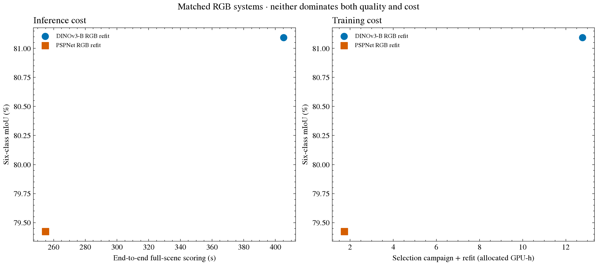

# Quality and computational cost on the Potsdam benchmark cohort

## Matched DINOv3 and PSPNet systems

DINOv3-B RGB and PSPNet–ResNet101 RGB were scored on the same input cache and the same
14-scene, 467,862,855-pixel cohort. Both used eroded labels, $512 \times 512$ windows, stride
256, batch size 4, identity inference, and the same recorded Kaggle T4 allocation. The
two systems occupy different points in the measured quality–cost plane: DINOv3 has
higher mIoU, and PSPNet has lower full-scene scoring time and training/selection cost.
The GPU-hour accounting and its scope are registered as
[CLAIM-009](../../artifacts/public/evidence-manifest.json).

| Model | OA | mIoU | Full-scene scoring | Forward time | Peak allocated / reserved | Selection + refit GPU-h | Benchmark GPU-h |
| --- | ---: | ---: | ---: | ---: | ---: | ---: | ---: |
| DINOv3-B RGB | 92.0397% | 81.0932% | 405.23 s | 278.33 s | 691 / 1,028 MiB | 3.5291* | 0.2927 |
| PSPNet–ResNet101 RGB | 91.2834% | 79.4235% | 254.83 s | 110.01 s | 422 / 504 MiB | 1.7235 | 0.1831 |

*The DINOv3 selection + refit value above is the winning A arm plus refit only. The full
selection campaign trained A/B/C and confirmation D; its full selection and campaign
costs are given below and used for the complete-study Pareto plot.*

DINOv3 gains 0.7563 OA points and 1.6697 mIoU points over PSPNet. Its recorded
full-scene scoring takes 59.0% longer; PSPNet reduces scoring time by 37.1%. Forward
time is measured within the scoring profile, while full-scene scoring also includes
scene setup, Rasterio/cache reads, host–device transfer, weighted-logit accumulation,
and metric reduction. The difference is tied to this Kaggle allocation and batch size;
it is not a general hardware-independent speed ratio.

DINOv3 has higher IoU in all six classes and higher OA on 13 of 14 scenes. Its largest
class advantage is clutter/background (+5.1364 IoU points). The per-scene table and
class table are available at
[`scene quality`](data/potsdam-quality-cost-scenes.csv) and
[`class quality`](data/potsdam-quality-cost-classes.csv).



*Figure 1. Left: mIoU versus end-to-end full-scene scoring time. Right: mIoU versus
selection campaign plus 24-scene refit GPU-hours. The current figure is regenerated
after all A/B/C/D selection audit files are included; preflight and benchmark GPU-hours
are reported separately.*

## Compute accounting

The DINOv3 audit covers four full selection arms: A 2.9335, B 3.2024, C 2.8306, and D
3.2084 allocated GPU-hours. Together they use 12.1750 GPU-hours. Preflight adds 0.3775,
refit adds 0.5956, and benchmark inference adds 0.2927, for 13.4407 GPU-hours across the
recorded campaign. Selection plus refit costs 12.7705 GPU-hours. These values multiply
wall-clock execution from provider logs by all allocated GPUs and include bootstrap and
wrapper time recorded by the phase audits.

PSPNet selection, refit, and benchmark use 1.4399, 0.2836, and 0.1831 allocated
GPU-hours respectively, totaling 1.9066 GPU-hours. Selection plus refit is 1.7235 GPU
hours. DINOv3's full selection campaign therefore costs much more than PSPNet's single
selection phase. This reflects the number of alternatives tested as well as the model
and should not be described as an intrinsic per-epoch or per-inference model cost.

To make the scope visible, the CSV records both the winning A arm plus refit (3.5291
GPU-hours) and the full DINOv3 A/B/C/D selection campaign plus refit (12.7705 GPU-hours).
Only the latter is used for the study-level Pareto chart. Peak CUDA allocated and
reserved memory was measured by the supplemental paired inference after it reproduced
the archived confusion matrices. The measurements are PyTorch allocated/reserved peaks
on the active CUDA device (a Tesla T4); they are not system-wide process-memory totals.

## Paired inference resource measurement

The supplemental job used the same held-out cache and policy to create pixel maps
needed for the paired error analysis. It reproduced the original scene matrices before
local analysis. Model execution in that job took 417.01 seconds for DINOv3 and 277.54
seconds for PSPNet; total Kaggle runtime was 853.38 seconds. The archived scoring times
in the table remain the source for the matched scoring comparison because those runs
also recorded the stage profiles.

The successful run used 0.4741 allocated GPU-hours. Two earlier attempts failed during
the CUDA peak-memory setup before model inference; including those logged startup
attempts, the supplemental analysis used 0.5478 allocated GPU-hours, of which 0.0737
GPU-hours were failed startup time. This paired-inference cost is a shared one-time
analysis cost, not an additional per-model training cost.

## Pareto scope

Both models lie on the observed frontier for these two RGB recipes: neither has both
higher mIoU and lower measured cost. The frontier contains only these systems and this
hardware, cache, protocol, and experiment history. It is not an architecture ranking or
a deployment frontier for other GPUs, throughput targets, memory limits, or cities.
SAM and historical DINOv2 remain useful references, but their different input and tiling
recipes are not included in the matched RGB Pareto comparison.

Recreate model, scene, and class tables from audited artifacts:

```bash
uv run --locked --extra notebooks python scripts/research/potsdam_empirical.py \
  --runs-root /path/to/runs
```
