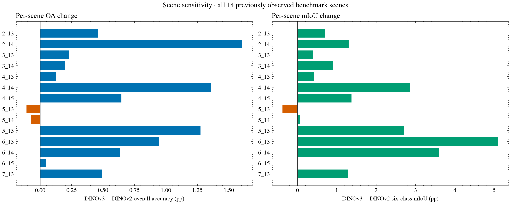
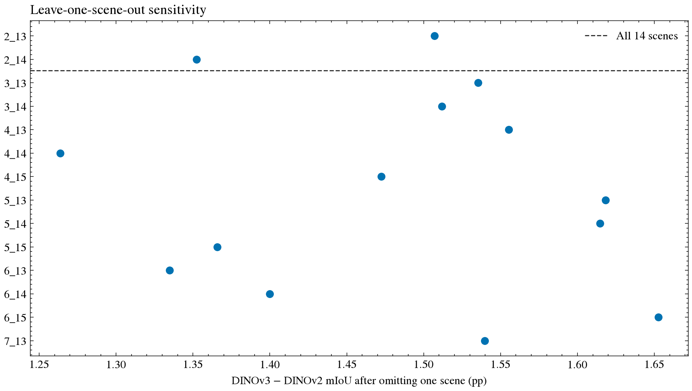

# Scene-level robustness of the historical DINOv3–DINOv2 comparison

## Results across the 14 recorded scenes

DINOv3 improves OA over DINOv2 on 12 of 14 scenes and improves six-class mIoU on 12 of
14. The OA regressions occur on `5_13` (−0.1080 percentage points) and `5_14`
(−0.0695). The mIoU regressions occur on `5_13` (−0.3804) and `6_15` (−0.0118).
Thus, the two models do not produce the same per-scene ordering for both metrics.
This descriptive scene result is registered as
[CLAIM-010](../../artifacts/public/evidence-manifest.json).

Scene `4_14` is the lowest-scoring DINOv3 scene: OA 85.9410% and mIoU 75.6118%.
`6_13` has the largest OA gain (+0.9443 points) and mIoU gain (+5.1022); `2_14` has the
largest OA gain (+1.6061). The largest gain depends on the chosen metric.

*Figure 1. DINOv3 minus DINOv2 by scene. The vertical line at zero makes regressions
visible; each result uses that scene's eroded-label pixels.*

## Macro average, global score, and leave-one-scene-out

| Aggregation | DINOv2 | DINOv3 | Change |
| --- | ---: | ---: | ---: |
| Global pixel-weighted OA | 91.4785% | 92.0397% | +0.5612 pp |
| Equal-weight macro-scene OA | 91.4746% | 92.0341% | +0.5595 pp |
| Global six-class mIoU | 79.6122% | 81.0932% | +1.4810 pp |
| Equal-weight macro-scene mIoU | 78.4460% | 79.8951% | +1.4491 pp |

The global and macro-scene changes are close for OA and differ by 0.0320 points for
mIoU. Omitting one scene at a time leaves the aggregate mIoU difference positive,
between 1.2636 and 1.6526 points. Excluding `4_14` produces the smallest remaining gain;
excluding `6_15` produces the largest.

*Figure 2. Each dot recomputes both aggregate confusion matrices after removing the
named scene. The dashed line is the complete 14-scene mIoU difference.*

## Scene-cluster uncertainty and class prevalence

A descriptive bootstrap resamples the 14 scene confusion matrices with replacement
(20,000 replicates, seed 42). The percentile interval is 0.296–0.846 OA points and
0.744–2.254 mIoU points; the median changes are 0.558 and 1.470 points. This is a
scene-resampling sensitivity summary, not a pixel-level significance test or a
guaranteed confidence interval for new cities. Fourteen scenes provide a small cluster
count, and spatial dependence may remain between scenes.

Correlations between scene class prevalence and scene-level score changes are
exploratory. For example, tree prevalence correlates with the same-class IoU gain at
Pearson r=0.681 and Spearman ρ=0.389; building prevalence correlates with scene OA gain
at r=−0.555 and ρ=−0.411. These are based on 14 scenes, have not been adjusted for
multiple comparisons, and should not be treated as causal or stable relationships.

Use [`scene robustness`](data/potsdam-scene-robustness.csv),
[`leave-one-out results`](data/potsdam-leave-one-scene-out.csv), and
[`prevalence correlations`](data/potsdam-scene-prevalence-correlations.csv) for the
full numbers. The bootstrap interval and sample size are also recorded in
[`analysis JSON`](data/potsdam-empirical-analysis.json).
